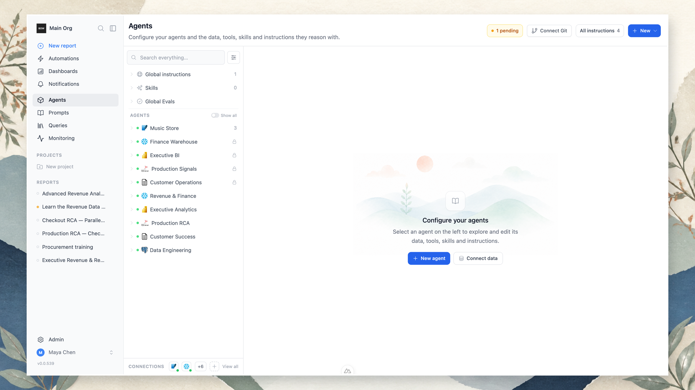

An agent packages the context and capabilities needed for a business or operational domain. It is not the same thing as a connection: a connection reaches a system, while an agent scopes one or more connections into a governed assistant for work such as Finance, Sales, System Logs, or Procurement.

An agent can include:

- One or many connections.
- Selected tables, semantic objects, files, directories, and tool providers.
- A description and conversation starters.
- Instructions shared with other agents or scoped specifically to this agent, a table, or an object.
- Eval suites that verify the agent’s expected behavior.
- Members, permissions, credentials, channel availability, and lifecycle status.

## Configure an agent

Open **Agents** from the main navigation and create a new agent, or select an existing one. Configure a clear domain name and description, then attach the data and tools it needs.

Keep the agent’s scope focused. An agent with a small, well-understood set of tables, files, and tools is easier to govern and usually produces better work than an agent attached to every available source.

## Scope data and tools

Use the agent tree to manage its capabilities:

- **Tables and objects** — enable only the database tables, BI objects, or semantic models the agent should use, and within a table, only the [columns](/data-sources/connecting#choose-which-columns-the-agent-sees) it needs.
- **Files** — upload reference files or attach file and directory connections.
- **Tools** — add MCP or Custom API connections, enable the tools that matter, and choose their approval policies.
- **Instructions** — add or attach reusable knowledge and behavior rules.
- **Evals** — organize suites and test cases beside the agent they verify.
- **Lists** — define tables the agent fills in from documents and data. See [Lists](/agents/lists).

## Chat and Training modes

Agents can be used in **Chat** mode for production work and **Training** mode for controlled improvement workflows. Instructions can apply to all modes, Chat only, or Training only. Use this distinction to test a new behavior before making it part of regular work.

## Access and delivery

An agent can be private to selected people and groups or made available to everyone in the organization. You can also control which channels can reach it, such as the web app, scheduled work, or external channels.

Agent managers set access in the agent's settings:

- **Access** — turn on public access to let everyone in the organization use the agent. The **Members** list then shows **Everyone in the organization** with **Can query**.
- **Members** — explicit members are listed whether or not the agent is public, so you can still add people (and groups, on Enterprise) and give them more than query access. Each member shows **Can query**, **Can manage**, or **Custom access**.

Select **Add member**, or edit an existing member, to open the same dialog. Choose who, then their access:

| Access | Allows |
|---|---|
| **Can query** | Ask this agent questions |
| **Can manage** | Configure the agent and manage its members |

For a narrower set of rights, open **Advanced permissions** and pick individual permissions such as **Manage instructions**, **Manage entities**, **Manage evals**, or **Manage members**. A member with a combination other than the two tiers shows as **Custom access**.

The owner can always manage the agent. **Remove** deletes a member's explicit membership and permissions only; they may still reach the agent through public, group, or organization access.

<CardGroup cols={2}>
  <Card title="Instructions and knowledge" icon="book-open" href="/agents/instructions">
    Manage reusable, many-to-many knowledge and behavior rules.
  </Card>
  <Card title="Evals and self-improvement" icon="badge-check" href="/agents/evals">
    Test agent behavior and turn verified failures into reviewed improvements.
  </Card>
  <Card title="Lists" icon="list" href="/agents/lists">
    Have the agent fill a typed table from documents and data, with a source quote for every value.
  </Card>
</CardGroup>
