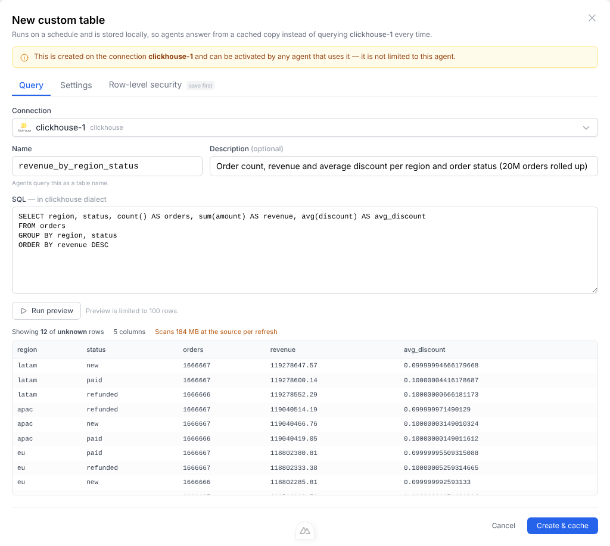
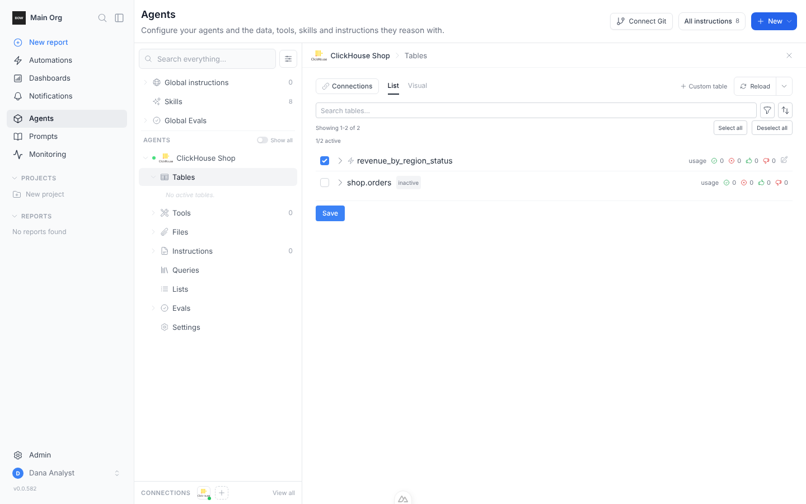

A custom query is the unit of work in BOW Fast: SQL an admin authors on a connection, materialized on a schedule into an encrypted local copy that agents query.

## Creating one

Open an agent's tables page and choose **Custom table**. The **New custom table** dialog has four tabs: **Query**, **Settings**, **Runs** and **Row-level security**. **Create & cache** saves the query and runs its first refresh.

Any connector that can run a query can hold a custom table — SQL databases and warehouses, and also connectors whose query is a request rather than SQL, such as Aria Operations.

### Query

Give the relation a name and write the SQL in the **source's own dialect** — this is the query BOW runs against your database. On a connector that does not speak SQL, write the query in that connection's own format, as its agent would send it — for Aria Operations, a JSON request.

The name is what agents will see, so `revenue_by_region` beats `q1`. It must start with a letter or underscore, use only letters, digits and underscores, and stay under 64 characters.

**Run preview** runs the query bounded to 100 rows and shows the columns you will get. Your SQL is executed exactly as written rather than wrapped in a subquery, so a preview of `ORDER BY amount DESC` shows the rows you actually asked for.

Where the source can say in advance what a query will cost, the preview shows that too — BigQuery reports it exactly and for free, via a dry run — along with a projection of what the schedule you have chosen will scan per day.

On ClickHouse the figure comes from `EXPLAIN ESTIMATE`, which reports how many rows the query will read without running it. ClickHouse reports rows, not bytes, so BOW prices those rows at the table's compressed size per row. That counts every column, so treat it as an upper bound: a query reading two columns of a wide table scans less.



<Tip>
  **Write the description.** It is the only thing telling an agent what the relation holds. `revenue_summary` on its own does not say whether it is per order, per region, or per month — and an agent that has to guess the grain will get it wrong.
</Tip>

### Settings

Choose the refresh schedule — either **Every** 15 minutes to 24 hours, or **Daily at** a fixed time in your organization's timezone — and [what each refresh fetches](#what-each-refresh-fetches). For a saved table, this tab also shows when it was last refreshed, how many rows are cached, when it refreshes next, and holds **Delete custom table**.

**Refresh now** at the bottom of the dialog runs a refresh straight away.

### Runs

Available once the query is saved. See [Run history](#run-history).

### Row-level security

Available once the query is saved. See [Row-level security](/bow-fast/row-level-security).

## Choosing a schedule

The schedule is a cost decision, not a freshness preference. With **Everything, every time**, each fire is a full run of your SQL against the source. For a large table, [**Only what is new**](#what-each-refresh-fetches) makes each fire much lighter.

| Data changes | Asked about | Reasonable interval |
| --- | --- | --- |
| Continuously | Many times an hour | Every 15–60 minutes |
| Through the day | A few times a day | Hourly, or daily at a fixed time |
| Nightly batch | Whenever | Daily, shortly after the batch lands |

If the answer to "how often will anyone ask this?" is "rarely", a daily refresh is almost always right.

On ClickHouse Cloud, also count wake-ups: every refresh wakes an idle service and keeps it awake until its idle timeout. Four refreshes a day is four wake-ups; an hourly schedule keeps the service up most of the day whether anyone asks or not. See the [break-even](/bow-fast/overview#what-it-costs).

## What each refresh fetches

Under **What each refresh fetches** in **Settings**, choose one of:

| Option | What a refresh does | Use it for |
| --- | --- | --- |
| **Everything, every time** (default) | Re-runs the whole query and replaces the copy | Small or aggregated results |
| **Only what is new** | The first load runs in chunks; after that each refresh reads only rows added or changed since the last one | Large tables, where re-reading everything is slow or costly |

### Settings for "Only what is new"

| Setting | What it means |
| --- | --- |
| **Cursor column** | A date, timestamp or ever-increasing number that grows whenever a row is added or changed, such as `updated_at`. Required. |
| **Re-read the last** | How far back before where the last refresh ended each refresh starts again, to catch rows that arrived late. In minutes, hours, days, or cursor values (for a numeric cursor). |
| **Can rows change after they are created?** | **Yes — match rows by a key, the newest version wins**: pick the key column(s) that identify one row, such as `id`. **No — rows are only ever added, or the query groups by a period**: no key needed; the re-read range is replaced as a whole. |

**Show advanced options** adds:

| Setting | What it means |
| --- | --- |
| **Full refresh every** | Rebuild the whole table every N days. This is the only way rows deleted at the source disappear from the copy. 0 turns it off. |
| **Start from** | Optional. Leaves older rows out of the first load, such as `2024-01-01`. |
| **Cursor type** | **Detect from the data**, or **Timestamp**, **Date**, **Number** or **Text**. Required when the query places the filter itself (see below). |
| **Query groups by** | **Nothing — one row per source row**, or **Hour**, **Day** or **Month**. Starts each refresh on a whole period, so no total is built from part of one. |

The table cannot be saved until the settings are complete — for example, until a cursor column is chosen, or key columns when rows can change.

By default, BOW adds the filter on the cursor column to your query for you. For a join or a large table, place the filter on the source column yourself with `{{since}}` (and optionally `{{until}}`), so the source can use its index:

```sql
SELECT id, customer_id, amount, updated_at
FROM orders
WHERE updated_at >= {{since}}
```

A query that uses `{{since}}` needs a **Cursor type** under advanced options.

<Note>
  Some sources cannot be asked for only the new rows. The dialog says so under **Only what is new**: each refresh still runs the whole query and keeps what is new from the result. Rows stay in the copy even after they leave the source's result, and **Full refresh every** does not apply: the table is rebuilt only when you choose **Full refresh**.
</Note>

When an incremental table is open, **Full refresh** at the bottom of the dialog rebuilds the whole table from the source. Use it to pick up deleted rows and changes older than the **Re-read the last** window. Saving a change to the query, or to settings that decide which rows belong in the table, also rebuilds it in full.

While the first load is running, **Settings** shows its progress in chunks. It continues on its own. Once loaded, **Loaded up to** shows where the next refresh will start reading.

### Row-drop guard

**Keep the previous data if a refresh loses more than N % of the rows** applies to both options. If a refresh would shrink the table by more than that share, the previous copy keeps serving and the run fails with the reason. New tables start with it on at 50%. If a drop is expected, raise the share or turn the guard off and refresh again.

### Column types

<Note>
  Decimal columns keep the type the source declares, across every batch and refresh. A column the source does not declare widens as larger values arrive, and is never rounded. Beyond 38 digits, a column becomes approximate (`DOUBLE`). When a query returns the same column name twice, such as `SELECT a.id, b.id`, both are kept, as `id` and `id_1`.
</Note>

## Activating it for an agent

A custom query belongs to the **connection**, and one copy is shared by every agent that uses it. Each agent then activates it separately, from its tables page — new agents start with it off.



That split is deliberate: a single extraction serves many agents, rather than N agents extracting the same data N times on N schedules. It also means the two actions need different permissions — authoring needs `manage_connection` on the connection, while switching an existing query on for one agent needs only `manage` on that agent.

## What the agent sees

The cached relation appears on a companion connection named `<your connection>::fast`, and it speaks **DuckDB SQL** regardless of what the underlying source supports. Joins, CTEs, and window functions work against a cached rollup exactly as they would against Postgres.

The agent is told the relation is cached, is asked to prefer it over re-deriving the same figures from raw tables, and is given two timestamps:

- **as of** — when the copy was last refreshed
- **next refresh** — when it refreshes next

Those belong together. "As of 09:00" means "perfectly current" on a daily schedule and "eight hours behind" on an hourly one, and only the pair lets an agent tell someone whether a figure is worth re-checking.

## Safeguards

An admin can write `SELECT * FROM orders` against a two-billion-row table. Three independent layers stop that taking anything down:

<Steps>
  <Step title="Refuse before running">
    Where the source can estimate a query without executing it, the estimate is checked at save time and before every refresh. A query projected to blow a ceiling is rejected with the reason.
  </Step>
  <Step title="Never materialize in memory">
    Rows stream from the source in batches straight into the copy, so memory use does not grow with result size.
  </Step>
  <Step title="Hard ceilings with a clean abort">
    On a breach the partial copy is discarded and **the previous one keeps serving**, so a runaway refresh degrades to stale data rather than no data.
  </Step>
</Steps>

Defaults:

| Ceiling | Default |
| --- | --- |
| Rows in the result | 5,000,000 |
| Size of the result | 2 GB |
| Time per refresh | 30 minutes |
| Bytes scanned at the source per refresh | 100 GB |

The scan ceiling is deliberately far larger than the result ceiling. A rollup that reads 50 GB to produce 5,000 rows is the _best_ kind of custom query, not one to refuse — that ceiling exists to catch a refresh that quietly costs real money every hour.

Only one refresh runs at a time per connection, and a refresh that is aborted or times out asks the source to stop the statement rather than abandoning it to run on unattended.

## Refresh status

Each custom query records the outcome of its last refresh — success, failure with the error, or in progress — along with how long it took and how many rows it produced. A failed refresh does not remove the previous copy; agents keep answering from the last good one until a refresh succeeds.

## Run history

The **Runs** tab lists every refresh of the table, kept for 30 days. **Reload** fetches the latest; **Show older** pages back.

| Column | Shows |
| --- | --- |
| **Started** | When the refresh started |
| **Why** | **Created**, **Schedule**, **Manual**, **Query changed** or **Continued** (a first load picking up where it paused) |
| **Kind** | **Full** or **New rows** |
| **Result** | **OK**, **Failed**, **Running**, **Paused**, **Cancelled** or **Interrupted** |
| **Read** | Rows read from the source |
| **Took** | How long it ran |

Select a run to see what it did: any error, **Read from source**, **Rows in table after**, **Added**, **Changed**, **Removed** and **Size**. For an incremental run it also shows the window — **Read from** and **Loaded up to** — and, for a load in chunks, which chunks are done. The **Log** lists each step, and **Query sent to the source** shows the exact query that ran, with the window filled in.

## Related

<CardGroup cols={2}>
  <Card title="Overview" icon="zap" href="/bow-fast/overview">
    What BOW Fast is for, what it costs, and which connectors support it.
  </Card>

  <Card title="Row-level security" icon="shield-check" href="/bow-fast/row-level-security">
    Filter one shared copy per person.
  </Card>
</CardGroup>
