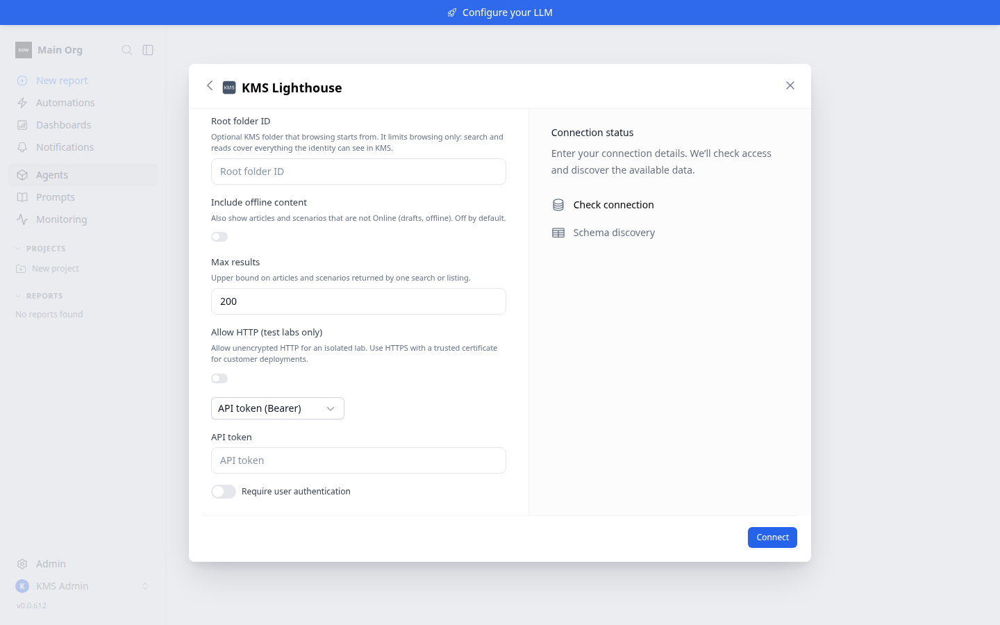
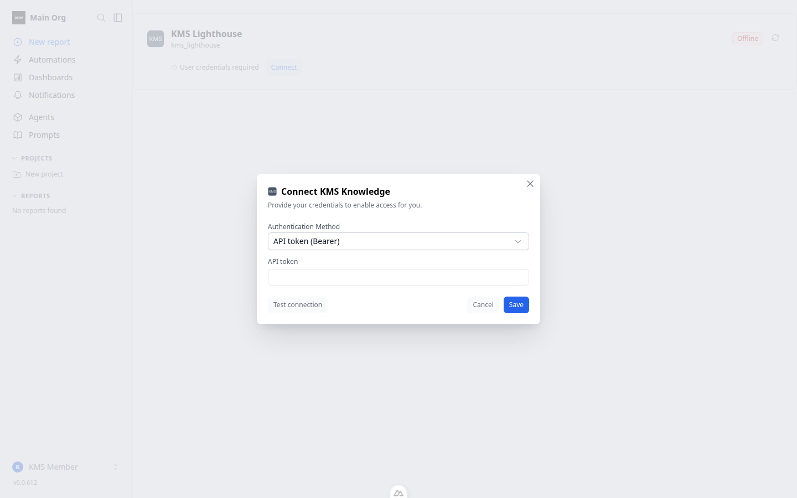
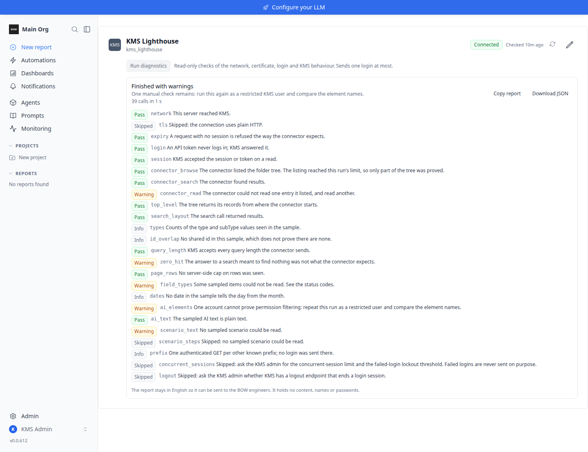

<Note>
  The KMS Lighthouse connector is part of the **Enterprise Edition**, and is currently in **beta**.
</Note>

BOW reads a KMS Lighthouse knowledge base through the **KMS Lighthouse public API**. Agents can search, browse and read KMS **articles** and decision-tree **scenarios**, the same way they work with any other file source.

The connector is **read-only**: it never writes to KMS. There is no index either. Every search, listing and read is a live call to KMS made as one KMS identity, so KMS permissions decide what each person sees.

## What the agent can do

- **Search** every article and scenario the KMS identity can see (limited to one layout when **Layout ID** is set).
- **Browse** the KMS folder tree, starting at the **Root folder ID** when one is set. Each entry has a path made of folder names, ending in the title, for example `Procedures/Accounts/Reset a password.txt`.
- **Read an article**: its title, kind, version, language, last update date and summary, followed by the article text grouped by tab.
- **Read a scenario**: the decision tree as an indented outline, with each step's text and the options that lead to the next steps. Images in a step are shown as links and are never fetched.

## Before you start

- An **Enterprise** license key. See [License Key](/enterprise/license).
- The **KMS Lighthouse URL** of your tenant, for example `https://example.lighthouse-cloud.com`.
- A **KMS account allowed to use the KMS public API**. Ask your KMS administrator for one. For a shared connection this is usually a dedicated service account whose KMS permissions cover the content the agents should see.
- An **API token** for that account (recommended), or its username and password.
- **Network access** from the BOW server to the KMS tenant over HTTPS. The connector does not use an outbound proxy, so BOW must be able to reach the tenant directly.

<Tip>
  People who sign in to KMS only through single sign-on may have no KMS password. Give them an API token, or a separate account for the API.
</Tip>

## Connect in BOW

Go to **Data Sources → Add data source** and choose **KMS Lighthouse**. Fill in the fields, pick an authentication method, then click **Connect**.

<Frame>
  
</Frame>

### Fields

| Field | Required | Default | Notes |
| :-- | :-- | :-- | :-- |
| **KMS Lighthouse URL** | Yes | — | Tenant base URL, for example `https://example.lighthouse-cloud.com`. You can paste it with the API prefix included. It must not contain a user name or password, a query or a fragment. |
| **API path prefix** | No | `/kms/lh/api` | Path of the KMS public API under the base URL. Change it only if your tenant serves the API elsewhere. |
| **Layout ID** | No | — | A KMS layout that search is limited to. Leave blank to search every layout the identity can see. Browsing and reading ignore it. |
| **Root folder ID** | No | — | The KMS folder that browsing starts from. It limits **browsing only**; see [What the root folder does](#what-the-root-folder-does). `0` is a valid value. |
| **Include offline content** | No | Off | Also show articles and scenarios that are not Online (drafts, offline). |
| **Max results** | No | `200` | 1 to 1000. Upper bound on articles and scenarios returned by one search or listing. Folders do not count. |
| **Allow HTTP (test labs only)** | No | Off | Allow unencrypted HTTP for an isolated lab. Use HTTPS with a trusted certificate for customer deployments. |

## Authentication

Choose the method in the authentication dropdown. Both methods work for a shared connection and for per-user connections.

**API token (Bearer)** (the default, and the recommended method)

| Field | Required | Notes |
| :-- | :-- | :-- |
| **API token** | Yes | KMS Lighthouse access token for this identity. It can contain only plain letters, digits and punctuation, with no spaces. Blanks around a pasted token are removed. |

The token is sent with every call and never logs in. When KMS refuses it, the token is wrong or no longer valid: get a new one from KMS and save it again.

**Password in URL (undocumented)**

| Field | Required | Notes |
| :-- | :-- | :-- |
| **Username** | Yes | KMS Lighthouse login name. Spaces around it are removed. |
| **Password** | Yes | Used exactly as typed. |

<Warning>
  This login relies on an undocumented KMS call that sends the password in the URL, where KMS, a firewall or a proxy can log it. BOW never logs it, but it cannot stop those systems from doing so. Use an API token when you can.
</Warning>

When KMS rejects a username and password, BOW sends no new login with that same username and password for **five minutes**. This keeps a wrong password from locking the KMS account through repeated retries. Saving a corrected password logs in again straight away.

## Shared or per-user access

The **Require user authentication** toggle on the connection form decides whose KMS account the agent reads with. See [Authentication and access](/data-sources/authentication) for how this works across connectors.

| Connection | Who | Reads as |
| :-- | :-- | :-- |
| Shared (toggle off) | Everyone with access to the agent | The connection's account or token |
| Per-user (toggle on) | A member who has connected | That member's own KMS account or token |
| Per-user (toggle on) | A member who has not connected | Nobody: BOW asks them to connect, and nothing is read from KMS |
| Per-user (toggle on) | An org admin, or someone allowed to manage connections, who has not connected | The connection's account or token |

<Note>
  On a per-user connection, an org admin (or someone allowed to manage connections) who has not connected their own account reads with the connection's account, not with their own KMS permissions. Connect your own account to read as yourself. Owning the agent does not change this: an owner who is not an admin connects like any other member.
</Note>

### Connect your own KMS account

On a per-user connection, each member connects once:

1. Open the agent and find the KMS Lighthouse connection, then click **Connect**.
2. Choose the **Authentication Method**: **API token (Bearer)**, or **Password in URL (undocumented)**.
3. Paste your token, or enter your KMS username and password.
4. Click **Test connection** to check it, then **Save**.

<Frame>
  
</Frame>

Your sign-in is stored encrypted on the connection and tied to your BOW account. Use **Disconnect** to remove it.

## What the root folder does

What one KMS identity can see is decided by KMS: that account's permissions, plus **Layout ID** for search. **Root folder ID** limits **browsing only**:

- Browsing, in the agent and on the agent's **Files** tab, starts at the root folder. A folder outside it cannot be opened.
- **Search** covers everything the identity can see in KMS (in the layout, when one is set).
- **Reading** works for any article or scenario the identity may open, also outside the root folder.

The agent's **Files** tab says the same: the KMS Lighthouse card shows **Browsing only** as its scope, with the note "A root folder limits browsing only. KMS permissions for the connected identity decide what the agent can search and read, including items outside that folder."

To keep content away from the agent, restrict the KMS account's permissions in KMS, or use a layout. The root folder does not do that.

## Online and offline content

By default only **Online** content is shown. Offline articles, scenarios and folders are left out of search and browsing, and reading one answers "Not found in KMS Lighthouse, or not available to this identity."

Turn on **Include offline content** to list, search and read offline content too. Each entry then shows whether it is online or offline.

## Test the connection

**Test connection** signs in, reads the top of the folder tree, and on success shows "Connected successfully" with a document count. That count comes from a short, bounded listing, so on a large knowledge base it is lower than the real total. A test with a username and password always logs in fresh.

The test can fail with these messages:

| Message | What it means |
| :-- | :-- |
| KMS Lighthouse did not accept the API token; it may be wrong or no longer valid. | Get a new token from KMS and save it again. On a per-user connection, the member reconnects. |
| KMS Lighthouse did not accept the login. Check the KMS username and password. | Check the username and password. On a per-user connection, the member reconnects. |
| … New login attempts with this account are paused for a few minutes. | KMS rejected this username and password recently. Wait five minutes, or save a corrected password. |
| KMS Lighthouse accepted the login but returned no session, so it cannot be used. / … refused the session it returned. | The account may not be allowed to use the KMS API. Ask the KMS administrator. |
| Connected to KMS Lighthouse, but the top level of the folder tree came back empty. | Set **Root folder ID** to a folder this account can open, or check the account's KMS permissions. |
| Connected to KMS Lighthouse, but root folder … came back empty. | KMS answers the same way for an empty folder and for a folder id that is not valid. Check **Root folder ID** and that the account can open that folder. |
| Connected to KMS Lighthouse, but KMS refused layout … Check Layout ID. | The **Layout ID** is not valid for this tenant. |
| KMS Lighthouse could not be reached. | BOW cannot reach the tenant. Check the URL, DNS and firewall from the BOW server. |

You can still save a connection whose test failed, so you can fix a wrong id afterwards. A shared connection that keeps failing its automatic checks is turned off. The agent then tells users that the KMS Lighthouse connection is inactive and to ask an admin to test it. One successful test turns it back on.

## Run diagnostics

When a connection does not behave as expected, **Run diagnostics** checks the network, the certificate, the login and how KMS answers, and produces a report you can send to BOW support.

<Frame>
  
</Frame>

- **Who can run it.** The button is on the KMS Lighthouse connection card of the agent, for people who can manage the connection.
- **What it sends.** Read-only checks only. It sends **at most one login**, never retries a rejected one, and respects the five-minute pause after a rejected password. It never writes to KMS.
- **How long it takes.** Up to 90 seconds. One run per connection at a time.
- **Whose account.** The same account the agent would read with for you: your own KMS sign-in on a per-user connection, or the connection's account (see [Shared or per-user access](#shared-or-per-user-access)).
- **What the report holds.** Check names, counts, status codes and pass or fail results, plus the host, the API prefix, the authentication method and the BOW version. It holds no document content, titles, folder names, usernames, passwords or tokens. The report stays in English so it can be sent to the BOW engineers.
- **Sharing it.** **Copy report** copies it to the clipboard; **Download JSON** saves it as a file. Copying needs an HTTPS address, so on a plain-HTTP install use **Download JSON**.

The result is one of **Automatic checks passed**, **Finished with warnings** or **Finished with a failure**. Each check is marked **Pass**, **Warning**, **Fail**, **Info** or **Skipped**.

One check cannot be finished by a single account: the report says "One manual check remains: run this again as a restricted KMS user and compare the element names." If you have a KMS account with fewer permissions, run diagnostics again as that user and send both reports. Two checks are always **Skipped** because they cannot be tested safely: ask your KMS administrator for the concurrent-session limit, the failed-login lockout threshold, and whether KMS has a logout.

### When a run fails

A failed run names the stage it stopped at ("Failed at: …").

| Stage | What it means | What to do |
| :-- | :-- | :-- |
| **network** | BOW could not reach KMS: a DNS failure, a refused or timed-out connection, a firewall or missing route, a host blocked by the BOW deployment's outbound policy, or a saved URL, API path prefix or Allow HTTP setting that cannot be used. | Check the URL, DNS and firewall from the BOW server. If KMS seemed to stall, run it again. If your network reaches the internet only through a proxy, see [Not supported](#not-supported). |
| **TLS** | The KMS certificate is not trusted, has expired or does not match the host name, or the TLS handshake failed. | Add your CA to the BOW backend's trusted CA bundle (`REQUESTS_CA_BUNDLE`). A device that inspects TLS needs its CA added too. |
| **login** | KMS rejected the login or token, the login is paused after a rejection, or KMS accepted the login but refused its session. | Check the username and password or the token. After a rejection, wait five minutes before running it again. If the session was refused, ask the KMS administrator whether the account may use the API. A device in front of KMS can also reject logins. |
| **browse** | The folder tree could not be listed. | Check the API path prefix and the account's KMS permissions. With no Root folder ID, try setting one. |
| **search** | Searches failed, or KMS answered in a way the connector cannot use. | If a Layout ID is set, check it. If KMS answered but the answer was broken, check any device in front of KMS first. |
| **read** | No listed article or scenario could be read. | Check the account's KMS permissions, and send the report to BOW support. |

## Limits

- **Results per search or listing** are capped by **Max results**. A search that hits the cap says its results may be incomplete. A long listing can stop before the end of a large folder tree, so the agent opens a specific folder by its path or searches instead.
- **Search text** is limited to 200 characters; the rest is cut.
- **Very large scenarios** are shortened, with a marker where steps are not shown.
- **Renaming a folder** in KMS changes the paths of everything in it.

## Not supported

- **Outbound proxies.** The connector does not use proxy settings. A site that reaches KMS only through a proxy cannot use it.
- **The KMS secret-key (hash) login** from the KMS "API users" area. Use an API token or a username and password.
- **Single sign-on or OAuth** to KMS.
- **Writes** of any kind to KMS.
- KMS AI answers, suggestions, categories, glossary terms, related items, attachments, and images.

## Troubleshooting

<AccordionGroup>
  <Accordion title="An item outside the root folder still shows up in search">
    This is expected. **Root folder ID** limits browsing only. Search and reads follow the KMS account's permissions. To hide content, restrict the account in KMS or use a **Layout ID**.
  </Accordion>

  <Accordion title="A member is asked to connect">
    The connection is per-user and that member has not saved their own KMS sign-in. They click **Connect** and add their token or login. This includes a data-source owner who is not an org admin.
  </Accordion>

  <Accordion title="An admin sees more than their own KMS account allows">
    On a per-user connection, an admin or connection manager who has not connected their own account reads with the connection's account. Connect your own account to read as yourself.
  </Accordion>

  <Accordion title="The login fails again right after fixing the password in KMS">
    After a rejected login, BOW waits five minutes before trying the same username and password again. Wait, or save the corrected password on the connection, which logs in straight away.
  </Accordion>

  <Accordion title="The API token is refused when saving">
    The token can contain only plain letters, digits and punctuation, with no spaces. Copy it again from KMS Lighthouse and paste it as plain text.
  </Accordion>

  <Accordion title="The agent says the KMS Lighthouse connection is inactive">
    A shared connection that keeps failing its automatic checks is turned off. Fix the cause, then test the connection again. One successful test turns it back on.
  </Accordion>

  <Accordion title="Offline or draft articles are missing">
    Only Online content is shown by default. Turn on **Include offline content**.
  </Accordion>

  <Accordion title="The document count after Test connection seems low">
    The count comes from a short, bounded listing, so it is lower than the real total on a large knowledge base. Search and reads are not limited by it.
  </Accordion>

  <Accordion title="Diagnostics are cut off on a large or slow tenant">
    A gateway or load balancer in front of BOW with a 60-second read limit can end a run early. Raise that limit for this request, or run diagnostics from inside the network.
  </Accordion>
</AccordionGroup>

## Related

- [OpenText Documentum](/data-sources/connectors/documentum) — another live, read-only document connector where the source system's permissions apply.
- [SharePoint Server (on-prem)](/data-sources/connectors/sharepoint-server) — on-premises document libraries with shared or per-user Windows credentials.
- [Authentication and access](/data-sources/authentication) — shared vs per-user credentials across connectors.
