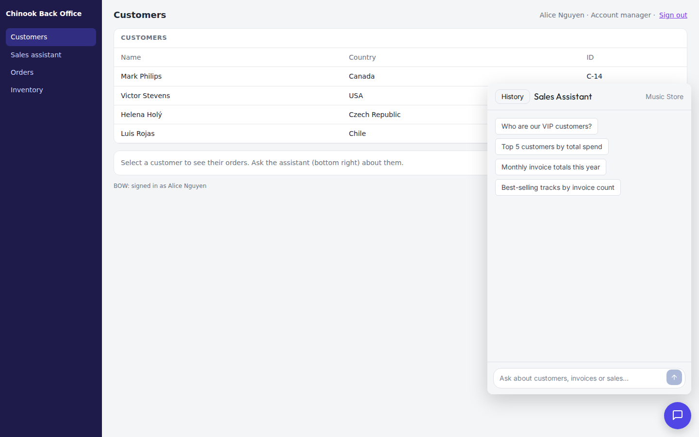
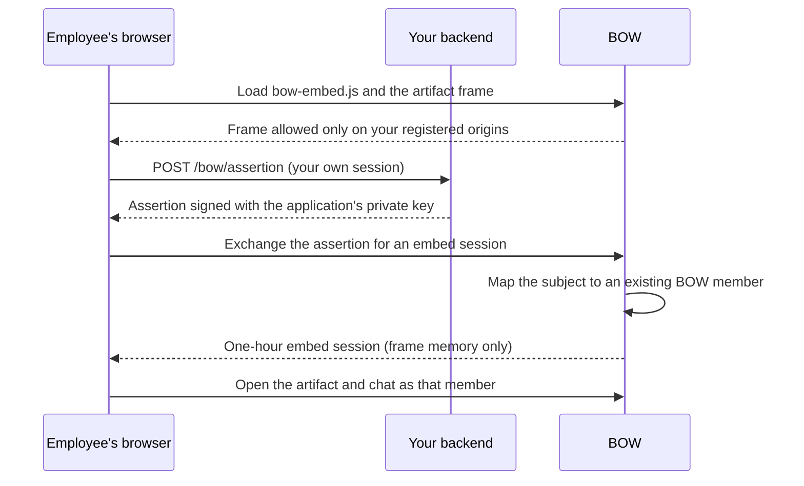
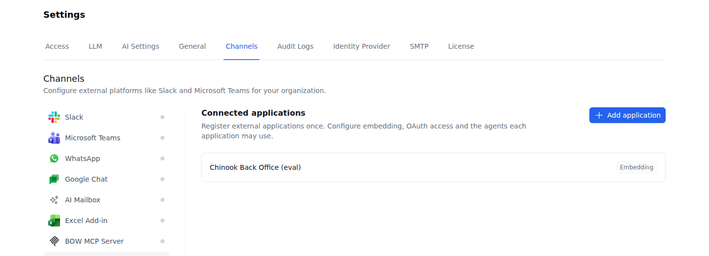
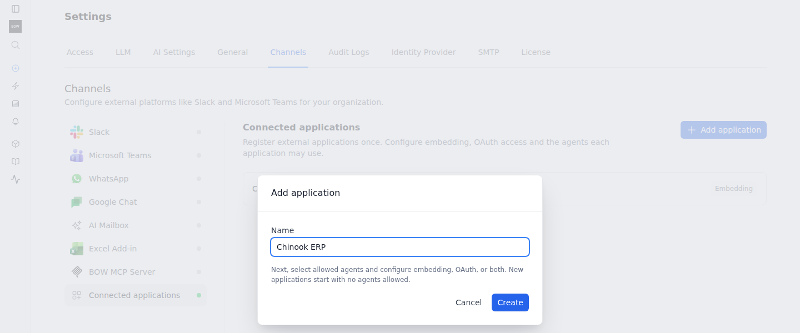
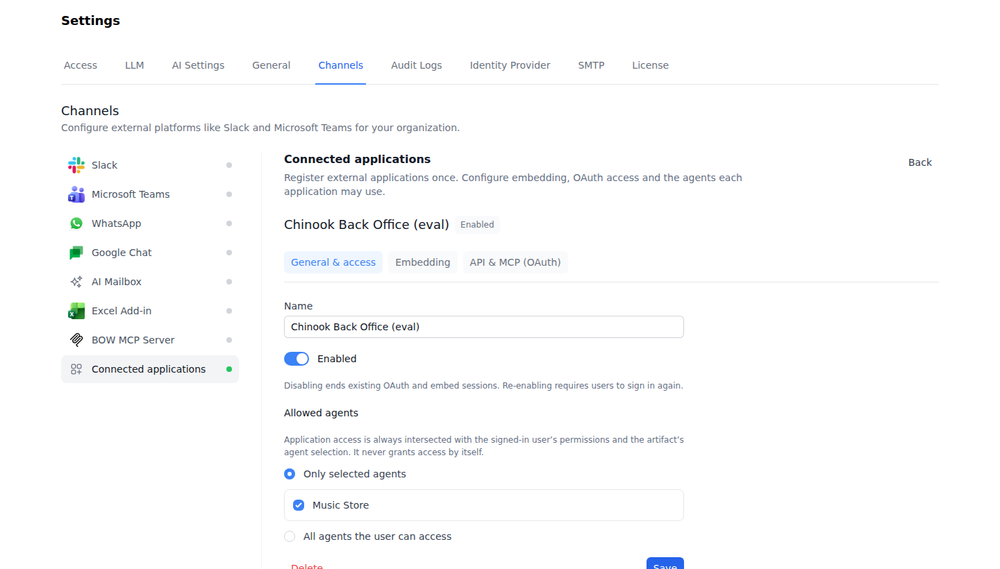
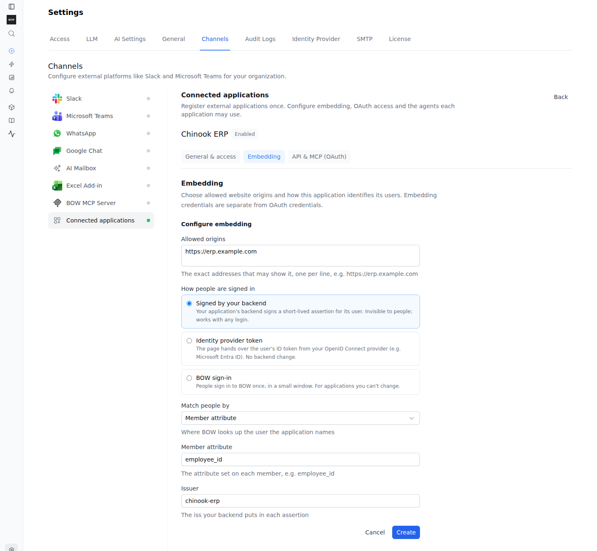
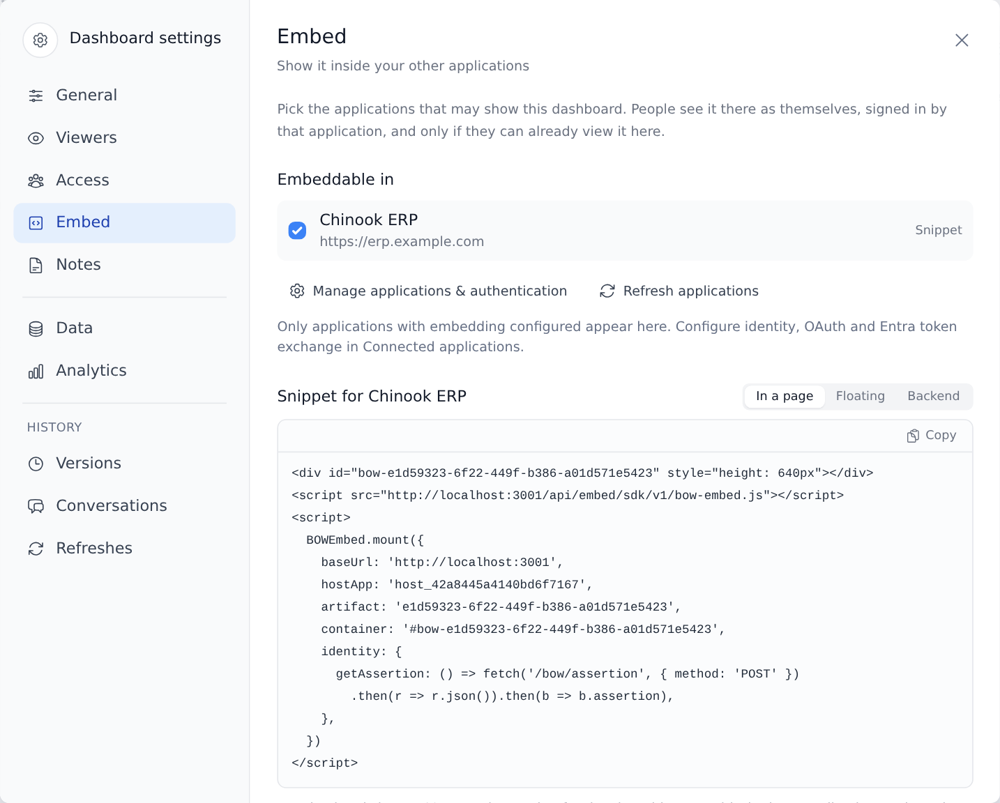
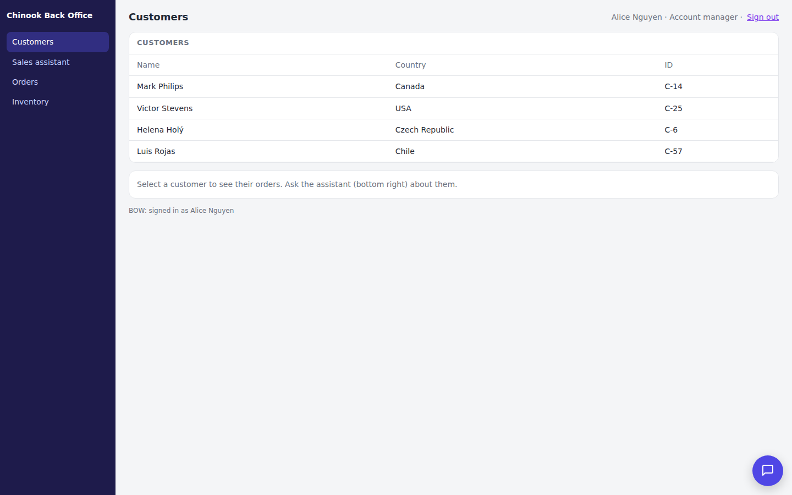
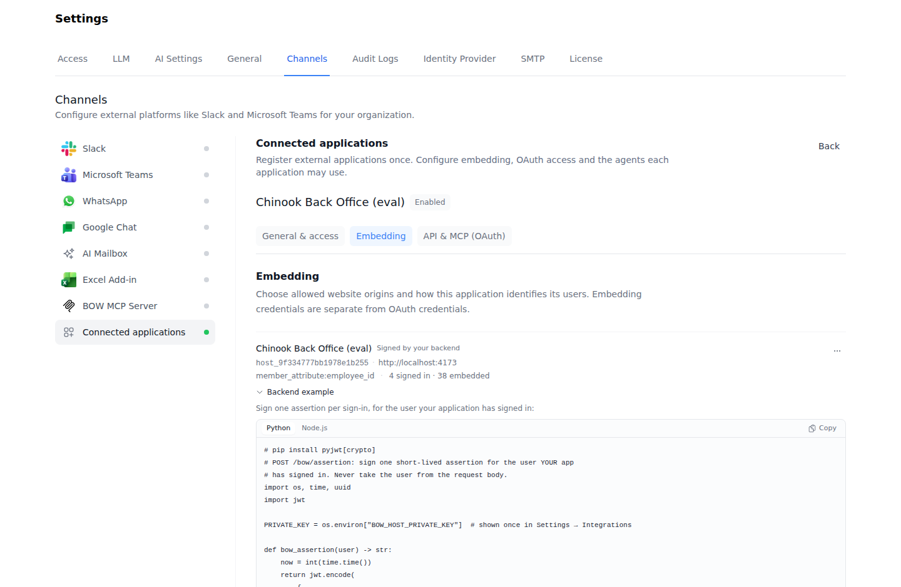
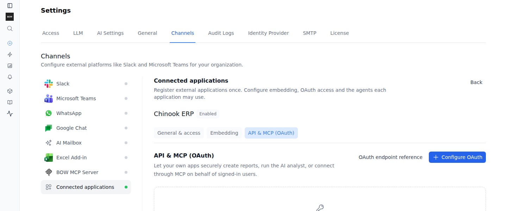

A BOW artifact can run inside your own system: an ERP, a back office, a ServiceNow portal or an intranet page. The usual case is a chat assistant that an agent built in BOW. Your employees open it in the system they already use, see it as themselves, and get answers from the agents and data they are allowed to use in BOW.

This guide is for the IT or integration team that connects the two systems. To build the assistant itself, see [Build a chatbot app](/using-bow/chat-apps). For every option, method and event, see the [reference](/using-bow/chat-components-reference).



## Choose an approach

BOW offers two ways to put a chat in front of your users.

| | Embed a BOW chat assistant (this guide) | [Build your own chat on the Completions API](/guides/embed) |
| --- | --- | --- |
| Who builds the interface | An agent builds it in BOW from ready-made chat components; you restyle it by asking in chat | Your developers build and maintain it |
| What you add to your system | One script tag and a call to `BOWEmbed.mount` | A full chat UI, streaming parser and API client |
| How users sign in | Your backend vouches for them, your identity provider's token, or a BOW sign-in window | OAuth 2.1 with PKCE |
| Credential in the browser | A one-hour embed session, held only in the frame's memory | An OAuth token, ideally kept on your backend |
| What the credential can reach | Only the artifacts that allow your application | The BOW API, with the user's permissions |
| Best for | An assistant, dashboard or data app inside an ERP or portal with little custom code | A product feature that needs full control of the UI and the API |

Both approaches run every request as a real BOW user with that user's permissions.

## How it fits together

You configure three things:

1. A **Connected application** in BOW: one registration per system, with the website origins that may show BOW, how that system identifies its users, and the agents it may use.
2. The **artifact**: the chat assistant, published, shared with the right people, and set to allow your application.
3. Your **host page**: it loads the SDK from your BOW deployment and mounts the artifact. In the recommended setup, your backend signs a short assertion for the signed-in employee.



## Before you start

- An administrator with the `manage_settings` permission, to register the application.
- An editor of the chat artifact, to publish it, share it and allow the application. The artifact's **Embed** tab also needs the organization permission `publish_reports`: with it, people who can edit the artifact can see the tab, and people who can change the artifact's settings can save it.
- An agent with connected data and a working model. The [Music Store demo](/guides/demo-dataset) works for a first integration.
- Employees who are already members of your BOW organization, or an identity source that can create them on first sign-in.
- A host page that can load a script and show an iframe from your BOW deployment. On managed platforms such as ServiceNow, use a custom page or component that allows this. There is no BOW plugin for those platforms.

## 1. Build and publish the assistant

Ask an agent in BOW to build the assistant, for example:

> Build a sales assistant for our back office: a chat with the Music Store agent, with previous conversations listed on the side. The host application will provide the floating button.

The **Build a chat assistant** skill guides the agent. See [Build a chatbot app](/using-bow/chat-apps) for what to ask for, how to choose its agents and model, and how to test it.

Then:

1. Publish the artifact.
2. Use **Share** to give the intended people or groups view access. The artifact's **Settings → Access** shows who can open it.

Publishing, sharing and allowing an application are three separate requirements. Embedding never widens the audience: an employee who cannot open the artifact in BOW cannot open it in your system either.

## 2. Register the application

Open **Settings → Channels → Connected applications**. One registration covers embedding, OAuth API access, or both, for one system.



<Steps>
  <Step title="Add the application">
    Select **Add application** and enter a name, such as **Chinook ERP**. Use one registration per system and environment, not one per artifact.

    
  </Step>
  <Step title="Choose its agents">
    In **General & access**, under **Allowed agents**, select **Only selected agents** and check the agents the assistant needs, then select **Save**.

    New applications start with no agents allowed. **All agents the user can access** removes the application's limit. Either way, the application only narrows access: an employee can use an agent only when the application allows it, the employee can use it in BOW, and the artifact's own agent settings include it.

    
  </Step>
  <Step title="Configure embedding">
    Open **Embedding** and select **Configure embedding**. Fill in:

    - **Allowed origins**: the exact origins of your system, one per line, for example `https://erp.example.com`. An origin is the scheme, host name and port. Do not include a path. Add development, staging and production origins separately. An application can list up to 20 origins.
    - **How people are signed in**: the identity mode. See [Identity modes](#identity-modes) below.
    - **Match people by**: for the backend-signed and identity-provider modes, where BOW looks up the person your system names.
    - **Issuer** (backend-signed mode) or **Audience** (identity-provider mode).
    - **Create people on first sign-in**: off by default. Leave it off when every employee already exists in BOW. See [Match people by](#match-people-by) for what it needs.

    
  </Step>
  <Step title="Store the private key">
    In **Signed by your backend** mode, BOW generates a key pair when you select **Create**. It shows the private key once, next to a ready-made backend example. Copy the key into your backend's secret store and select **I stored it**. BOW keeps only the public key.
  </Step>
</Steps>

The application's row under **Embedding** shows its mode, its public ID (`host_…`), its origins, how people are matched, and how many people are signed in and how many artifacts allow it. The actions menu has **Edit**, **Rotate key** (backend-signed mode) and **Sign everyone out**.

<Note>
  The public ID is not a secret: it appears in the snippet on your page. The private key is the only embedding secret. It is separate from any OAuth client secret on the same application.
</Note>

## 3. Allow the artifact in your application

In BOW, open the artifact, then its settings and the **Embed** tab.

1. Under **Embeddable in**, check your application. Only applications with embedding configured appear here. If yours is missing, use **Manage applications & authentication** to finish its setup, then **Refresh applications**.
2. Select **Snippet** next to the application, and choose **Floating**, **In a page** or **Backend**.



The snippet already contains your BOW address, the application's public ID and the artifact's reference. Use that reference; it is the artifact's name or ID, not the ID of one saved version.

## 4. Add the SDK to your page

The SDK is served by your own BOW deployment at `/api/embed/sdk/v1/bow-embed.js`. No public CDN is involved, so it also works in an air-gapped network.

<Tabs>
  <Tab title="Floating">
    The SDK adds a round launcher button in the corner of the page and opens the artifact in a panel above it.

    ```html
    <script src="https://bow.example.com/api/embed/sdk/v1/bow-embed.js"></script>
    <script>
      const embed = BOWEmbed.mount({
        baseUrl: 'https://bow.example.com',
        hostApp: 'host_…',               // from the snippet
        artifact: 'sales-assistant',     // from the snippet
        mode: 'floating',
        title: 'Sales assistant',        // frame title and launcher label
        accentColor: '#4f46e5',          // launcher color
        position: 'bottom-right',        // or 'bottom-left'
        identity: {
          getAssertion: () => fetch('/bow/assertion', { method: 'POST', credentials: 'same-origin' })
            .then(r => r.json()).then(b => b.assertion),
        },
      });
    </script>
    ```
  </Tab>
  <Tab title="In a page">
    The artifact fills a container you provide. Give the container a height.

    ```html
    <div id="bow-assistant" style="height: 640px"></div>
    <script src="https://bow.example.com/api/embed/sdk/v1/bow-embed.js"></script>
    <script>
      const embed = BOWEmbed.mount({
        baseUrl: 'https://bow.example.com',
        hostApp: 'host_…',
        artifact: 'sales-assistant',
        container: '#bow-assistant',
        identity: {
          getAssertion: () => fetch('/bow/assertion', { method: 'POST', credentials: 'same-origin' })
            .then(r => r.json()).then(b => b.assertion),
        },
      });
    </script>
    ```
  </Tab>
</Tabs>

Keep `baseUrl` at the BOW site root, without `/api`. Call `BOWEmbed.mount` after `<body>` exists: in floating mode `mount()` appends the panel and launcher to `document.body`.

| Launcher closed | Launcher open |
| --- | --- |
|  |  |

In floating mode the SDK owns the launcher and the open and closed state. Closing the panel hides it without unloading it, so a running answer and the open conversation are still there when the employee reopens it. You can also call `embed.open()` and `embed.close()` from your own buttons. The chat inside should be a full-height surface without a launcher of its own; the chatbot skill builds it that way.

`title`, `accentColor` and `position` style only the outer launcher and panel. The look of the assistant itself comes from the artifact: change it by asking the agent.

## Identity modes

Each application has exactly one identity mode. Every mode ends the same way: a real BOW user who is an active member of the organization, and an embed session for that user and that application.

| Mode | In the form | What the employee sees | What you build |
| --- | --- | --- | --- |
| Signed assertion | **Signed by your backend** | Nothing: they are signed in silently | A backend endpoint that signs a short assertion for the signed-in user |
| Identity provider token | **Identity provider token** | Nothing, as long as your page can get an ID token silently | A page callback that returns the user's current OpenID Connect ID token |
| SSO | **BOW sign-in** | A **Sign in** button in the frame, which opens BOW's sign-in in a small window | Nothing |

### Match people by

For the first two modes, **Match people by** decides what the subject in the credential means. The list shows the sign-in methods your deployment has configured:

| Choice | The subject is | Notes |
| --- | --- | --- |
| An OpenID Connect provider, for example Microsoft Entra ID | The user's identifier at that provider, read from the provider's configured identity claim (`uid_claim`, `sub` by default) | Available in both modes |
| Google | The user's Google subject | Signed assertion only |
| A SAML provider | The SAML subject used at sign-in | Signed assertion only |
| **Active Directory (LDAP)** | The user's LDAP subject, the AD `objectGUID` by default | Signed assertion only |
| **SCIM external id** | The `externalId` your identity provider sent through SCIM | Signed assertion only |
| **Member attribute** | The value of a member attribute you name, such as `employee_id` | Signed assertion only. Set the value per member in **Settings → Access → Members**: select the pencil icon (**Edit attributes**) next to the member's attributes, or **Add attribute** when the member has none |

BOW never matches people by email address. A subject that matches nobody, more than one person, or an inactive or non-member user is refused. With **Create people on first sign-in** on, an unknown person who is known to the selected directory joins through that directory's own admission rules (for example invitations or allowed domains) with the organization's default role. The option is not offered for SCIM or member attributes. It also has these limits:

- For an OpenID Connect, Google or SAML provider, the credential must carry the person's email address in an `email`, `preferred_username` or `upn` claim. Without one, the sign-in is refused.
- BOW refuses to create a person when that email address already has a BOW account. An existing account is linked only when the person signs in to BOW through the provider itself, never because a host names its email.
- It is not available for a SAML provider whose subject is the NameID. The provider must use an attribute as its subject.

### Signed assertion (recommended)

Use this mode when your system already knows who is signed in, whatever login it uses. Your backend signs a short RS256 JSON Web Token with the application's private key. The browser passes it to BOW and never sees the key.

| Claim | Value |
| --- | --- |
| `sub` | The signed-in employee's subject, as defined by **Match people by** |
| `iss` | The **Issuer** configured on the application |
| `aud` | The application's public ID (`host_…`) |
| `iat` | Now, in Unix seconds |
| `exp` | `iat` + 60 seconds. BOW refuses assertions that live longer than two minutes |
| `jti` | A new unique value for every assertion. BOW accepts each value once |
| `email` | Optional. The person's email address, required when **Create people on first sign-in** is on (see [Match people by](#match-people-by)). `preferred_username` or `upn` also work |

BOW allows 60 seconds of clock skew. Keep your server clock synchronized.

The endpoint lives on **your** backend; `/bow/assertion` is only the name the examples use. It must:

- take the user from your own authenticated session, never from the request body or a query parameter;
- accept only `POST`, with your usual same-site or CSRF protection;
- return a fresh assertion on every call, with `Cache-Control: no-store`;
- read the private key from your secret store.

The application's **Backend example** in BOW is pre-filled with your issuer and audience, and has a placeholder for the user field that holds the subject, such as `user.employee_id`. Below is a fuller version of the same examples:

<CodeGroup>

```python Python (Flask)
# pip install flask "pyjwt[crypto]"
import os, time, uuid

import jwt
from flask import Flask, jsonify, session

app = Flask(__name__)
app.secret_key = os.environ["FLASK_SECRET_KEY"]

PRIVATE_KEY = os.environ["BOW_HOST_PRIVATE_KEY"]  # shown once when embedding was configured
ISSUER = "chinook-erp"                             # the application's Issuer
AUDIENCE = "host_…"                                # the application's public ID


def bow_assertion(subject: str) -> str:
    now = int(time.time())
    return jwt.encode(
        {"sub": subject, "iss": ISSUER, "aud": AUDIENCE,
         "iat": now, "exp": now + 60, "jti": uuid.uuid4().hex},
        PRIVATE_KEY,
        algorithm="RS256",
    )


@app.post("/bow/assertion")
def assertion():
    user = session.get("user")  # your own signed-in user, never the request body
    if not user:
        return jsonify(error="not signed in"), 401
    response = jsonify(assertion=bow_assertion(str(user["employee_id"])))
    response.headers["Cache-Control"] = "no-store"
    return response
```

```javascript Node.js (Express)
// npm install express jsonwebtoken
import crypto from 'node:crypto'
import express from 'express'
import jwt from 'jsonwebtoken'

const app = express()
const PRIVATE_KEY = process.env.BOW_HOST_PRIVATE_KEY // shown once when embedding was configured
const ISSUER = 'chinook-erp'                         // the application's Issuer
const AUDIENCE = 'host_…'                            // the application's public ID

// requireLogin is your existing session middleware that sets req.user
app.post('/bow/assertion', requireLogin, (req, res) => {
  const assertion = jwt.sign(
    { sub: String(req.user.employeeId) },            // never take the user from the request body
    PRIVATE_KEY,
    { algorithm: 'RS256', issuer: ISSUER, audience: AUDIENCE,
      expiresIn: 60, jwtid: crypto.randomUUID() },
  )
  res.set('Cache-Control', 'no-store').json({ assertion })
})
```

</CodeGroup>

On the page, `identity.getAssertion` calls that endpoint and returns the assertion string:

```javascript
identity: {
  getAssertion: async () => {
    const response = await fetch('/bow/assertion', { method: 'POST', credentials: 'same-origin' });
    if (!response.ok) throw new Error('Sign in to the back office again');
    return (await response.json()).assertion;
  },
},
```

The SDK calls it when the frame first signs in and again for each renewal. Return a string. If it throws or returns nothing, the SDK emits an `error` event with code `credential_failed`. On the first sign-in, `authRequired` with `status: 'failed'` follows and the frame shows the failure; during a renewal the frame keeps the current session and retries.

A callback that never settles emits no `error`. The frame stops waiting after 20 seconds and fails with "The host application did not answer", as `authRequired` with `status: 'failed'` on the first sign-in.



### Identity provider token

Use this mode when your page already holds an OpenID Connect ID token for the user, from a provider that BOW also uses for sign-in (for example Microsoft Entra ID through MSAL). There is no backend step: the provider vouches for the user.

1. In **Match people by**, choose that provider. Only configured OpenID Connect providers are listed in this mode.
2. Set **Audience** to the `aud` of the ID tokens your provider issues to your application, usually your application's client ID.
3. Return the current ID token from `identity.getIdToken`:

```javascript
identity: {
  getIdToken: () => msal.acquireTokenSilent({ scopes: ['openid'] }).then(r => r.idToken),
},
```

BOW checks the token's signature against the provider's published keys, its issuer, its audience and its expiry, then reads the provider's identity claim to find the member. Follow your identity library's renewal rules: if a token cannot be obtained silently, your page has to run the provider's interactive flow.

<Note>
  An ID token identifies the user to BOW. It is not a delegated access token, and this mode does not perform a token exchange or give BOW access to Power BI or Fabric on the user's behalf. For that, see [Microsoft Entra with token exchange](#microsoft-entra-with-token-exchange).
</Note>

### SSO with BOW sign-in

Use this mode when you cannot change the host system's code or backend. The frame shows **Sign in**. A click opens BOW's normal sign-in (a local account, OpenID Connect, SAML or LDAP, whatever your organization uses) in a small window on the BOW origin. The window hands a one-time code back to the frame and closes.

- The page needs no `identity` option.
- If the browser blocks the window, the frame says so. Allow pop-ups for the host page and select **Sign in** again.
- An existing BOW or identity-provider session can make the window close without asking for a password, but signing in to your system alone does not sign anyone in to BOW.
- The session cannot renew silently. When it ends, after about an hour, the frame asks the employee to sign in again.

### Microsoft Entra with token exchange

If your system signs employees in with Entra and the assistant must query Power BI or Fabric as each employee (on-behalf-of access), combine two capabilities of the same application:

1. In **API & MCP (OAuth)**, select **Configure OAuth**, choose the **BOW app** access surface, and turn on **Enable Entra token exchange**. Choose the **Entra SSO provider** and enter your **External Entra application (client) ID**.
2. Follow [External Entra applications](/guides/external-entra-applications): your backend requests a BOW-audience delegated token from Entra and exchanges it at BOW's token endpoint (OAuth 2.0 Token Exchange, RFC 8693). The exchange admits the user and provisions their delegated data connections. Keep the exchanged BOW token on your backend.
3. Configure **Embedding** in **Signed by your backend** mode, with **Match people by** set to your Entra provider. Configure that provider with `uid_claim: oid` and sign each assertion with the user's Entra object ID as `sub`. This matches people who have signed in to BOW through that Entra provider while `uid_claim: oid` was in place. A person admitted only by the token exchange is stored under a different identifier, so the assertion does not match them: the frame says their account isn't set up, or, with **Create people on first sign-in** on, refuses to create them because their email address already has a BOW account. Ask such people to sign in to BOW once through the Entra provider.
4. Configure the per-user [Power BI](/data-sources/connectors/power-bi) or [Fabric](/data-sources/connectors/microsoft-fabric) connection and the required consent, and test real queries as two users with different permissions.

<Warning>
  Changing `uid_claim` on a provider that already has users does not update the identifiers BOW stored for them. Each existing member keeps the old value, for example their `sub`, until they sign in to BOW through the provider again. Until then, an assertion that sends their object ID matches nobody.
</Warning>



The OAuth client secret and the embedding private key are separate credentials. An embed session alone never establishes delegated access to a downstream system.

## Pass the current record as context

Tell the assistant what the employee is looking at, such as the customer on screen:

```javascript
const embed = BOWEmbed.mount({
  // …
  context: { customerId: 'C-1042', customerName: 'Mark Philips' },
});

// When the employee opens another customer:
embed.updateContext({ customerId: 'C-1043', customerName: 'Victor Stevens' });
```

`context` must be a plain JSON object. `updateContext` replaces the whole object.

What happens to it depends on the artifact:

- An app built from the chat components reads it as `useArtifactData().host_context` and decides how to use it, for example by showing which customer the chat is about and including the value in the question it sends. App conversations do not forward it to the agent on their own. See [Use host context](/using-bow/chat-apps#use-host-context).
- BOW's built-in chat bubble, on an artifact that has no chat of its own, sends the current context with each question. BOW keeps it only when it is a JSON object of at most 20 keys and 2,048 characters, and tells the agent that it is unverified information from the host application.

<Warning>
  Host context is advisory. It is never used as identity, role, permission, filter or instruction, and it grants no access. The agent still runs as the signed-in employee, so a page cannot widen what that person can see by naming another customer, user or role. Put real access rules in BOW: agent access, per-user connections and [row-level security](/bow-fast/row-level-security).
</Warning>

## Sign-out and switching users

When an employee signs out of your system, or another employee takes over the same browser:

```javascript
embed.on('authRequired', ({ status }) => {
  if (status !== 'signed_out') return;
  // The frame is sending its sign-out request now. Give it a moment to leave.
  setTimeout(() => embed.destroy(), 1000);
});
embed.logout();   // asks the frame to end its BOW embed session
// …end your own session, then mount again for the next user
```

`logout()` only sends a message to the frame. The frame then discards the session, emits `authRequired` with `status: 'signed_out'`, and asks BOW to revoke the session (`DELETE /api/embed/{host}/session`). `destroy()` removes the frame and launcher and stops listening.

<Warning>
  Do not call `destroy()` right after `logout()`. The frame is removed before it handles the sign-out message, so the session is discarded without being revoked: no request reaches BOW, no `authRequired` event fires, and the session stays valid on the server until it expires, up to one hour later. Wait for `signed_out` first. Destroying the frame in the same moment as that event can still cancel the revocation request on a slow network, so leave it a short pause, as above. If the frame never finished loading, no event arrives, so also destroy it after a timeout of your own.
</Warning>

Your assertion endpoint must stop issuing assertions for the old session. If the frame signs in a different person while mounted, it unloads the previous person's app first, so nothing of theirs remains on screen.

## Listen to events

```javascript
embed.on('authenticated', ({ user }) => console.log('BOW user', user.name));
embed.on('authRequired', ({ status, message }) => console.warn('BOW sign-in', status, message));
embed.on('unavailable', ({ reason, message }) => console.warn('BOW artifact unavailable', reason));
embed.on('error', ({ code, message }) => console.error('BOW', code, message));
```

| Event | When | Detail |
| --- | --- | --- |
| `authenticated` | The frame signed the user in and is showing the artifact. Also sent after an `unavailable` artifact becomes available | `{ user: { name, email } }` |
| `authRequired` | The frame is not signed in: it needs a sign-in, sign-in failed, the user signed out, or the session ended | `{ status, message }` |
| `unavailable` | The user is signed in, but this artifact cannot be shown to them here | `{ reason, message }` |
| `error` | Your `getAssertion` or `getIdToken` callback failed or returned nothing | `{ code: 'credential_failed', message }` |
| `open`, `close` | The floating panel opened or closed | `{}` |

## When the artifact cannot be opened

BOW lets your page frame the artifact only when the artifact exists and allows an enabled application. It then names the application's allowed origins in the frame policy. Otherwise the browser refuses the frame and the SDK emits no event at all: `embed.state.status` stays `'starting'`. This happens with a wrong artifact reference, an artifact that does not allow this application, a disabled application, or a page origin that is not listed. Treat a `'starting'` state that lasts too long as a failure, with a timeout of your own.

When the frame loads and the employee is signed in but cannot open the artifact, the frame shows a message in place of the artifact and the SDK emits `unavailable`:

| `reason` | Message in the frame | What to do |
| --- | --- | --- |
| `not_published` | This hasn't been published yet. It will appear here once it's published. | Publish the artifact. Only its editors and admins see this reason; everyone else gets `not_found` |
| `not_found` | This isn't available. It may not be published yet, or it was removed. | Publish the artifact. An artifact removed while the frame is open is reported the next time the frame loads it, for example after a new sign-in. Until then, the app's requests fail with `artifact.not_found` |
| `denied` | You don't have access to this. Ask its owner to share it with you. | Share the artifact with this person or their group |
| `not_allowed` | This isn't enabled for this application. An editor can allow it in its Embed settings in Bag of Words. | Check your application under **Embeddable in** on the artifact's Embed tab. When the artifact stops allowing the application while the frame is open, this is reported the next time the frame loads the artifact, for example after a new sign-in. Until then, the app's requests fail with `embed.not_allowed` and the app shows "This isn't available in this application." |
| `failed` | This couldn't be loaded. Try again in a moment. | A server or network error. The frame offers **Try again** |

The session stays signed in during these states. When the artifact becomes available, for example after it is shared, the frame shows it at the next renewal or retry and the host receives `authenticated`. A failed sign-in arrives as `authRequired`. An application disabled while the frame is open ends its sessions. This arrives as `authRequired` with `status: 'failed'` (`sign_in_required` in BOW sign-in mode) once the frame notices, at the latest when the current session would have ended. Until then, the app's own calls fail with `embed.session_invalid`.

## Sessions and renewal

- An embed session lasts one hour. It is held only in the frame's memory: never in a URL, a cookie or browser storage.
- In the backend-signed and identity-provider modes, the frame renews the session silently about five minutes before it ends, by asking your page for a new credential. A renewal keeps the open conversation and any running answer.
- If a renewal fails, the frame keeps the current session and retries after 15, 30, 60 and then every 120 seconds, until the session really ends. A person BOW does not know, knows twice, or has deactivated is refused at once without retries.
- In SSO mode the frame asks the employee to sign in again when the session ends.
- BOW rechecks every request: that the session has not expired, the application is still enabled, the user is still active and a member, and the artifact still allows the application.
- **Sign everyone out**, **Rotate key**, disabling the application and deleting it end all its sessions on the server at once. So does saving a change to the identity mode, **Match people by**, **Issuer**, **Audience** or **Create people on first sign-in**. Re-enabling requires everyone to sign in again.
- An open frame is not told at once. It notices when it next loads the artifact's content or queries, and then emits `authRequired` with `status: 'failed'`. A chat-only app does not load those, so until the next renewal its conversation calls fail with `embed.session_invalid` and the frame shows no sign-in prompt. That can take up to about 55 minutes.
- In the backend-signed and identity-provider modes, that renewal asks your page for a new credential. After **Sign everyone out** your page usually provides one, so the frame signs the user straight back in and your page receives `authenticated`, not `authRequired`. **Sign everyone out** alone does not lock anyone out. To do that, stop issuing assertions or ID tokens for the person, or disable the application, or rotate the key. With a disabled application, or an assertion signed with the old key, the renewal fails, and the frame emits `authRequired` with `status: 'failed'` when its session would have ended. In SSO mode, the frame asks the employee to sign in again at that point.
- Changing **Allowed origins** ends no sessions. A frame already open on an origin you removed keeps working, and keeps renewing, until the page reloads. Use **Sign everyone out** as well, keeping in mind that in the backend-signed and identity-provider modes the frame's next renewal can sign the person straight back in.

## Security notes

- **Every viewer is a real BOW user.** There is no anonymous or shared "app" identity. Agents, connections, row-level security and audit logs all see the employee.
- **Access is the intersection of every layer.** To use an agent in the assistant, the application must allow it, the employee must be able to use it in BOW, and the artifact's agent settings must include it. To see the artifact, the employee must pass its normal sharing, and the artifact must allow the application.
- **Data access is per user.** Queries run with the employee's own access, including per-user connections. Selecting an agent for the application never grants anyone access to it.
- **Conversations are private.** Each employee sees only their own conversations on that artifact. Nobody else's are listed, opened or continued, including the artifact owner's.
- **The embed session is narrow.** It opens only the artifacts that allow its application. The rest of the BOW API refuses it.
- **The frame is locked to your origins.** BOW serves the artifact with a frame policy that names only the application's allowed origins, and only when the artifact allows that application.
- **Assertions are short and single-use.** RS256 only, at most two minutes long, one use per `jti`. The private key never leaves your backend.
- **Host context is advisory**, as described in [Pass the current record as context](#pass-the-current-record-as-context).
- **Sign-ins are rate-limited**: 30 per minute per client address per application, and 600 per minute per application. Chat messages are limited to 6 per minute per viewer per artifact and 60 per minute per organization.
- **Tools in app conversations** are currently limited to reading and querying data. Do not promise write actions or arbitrary MCP tools from an embedded assistant.

## Production checklist

<Steps>
  <Step title="Origins">
    Each environment's exact HTTPS origin is listed in **Allowed origins**. Nothing else is.
  </Step>
  <Step title="Identity">
    The mode and **Match people by** are set, and the subject you send matches what BOW stores for each employee. Test with ordinary employees, not only admins or the artifact owner.
  </Step>
  <Step title="Key">
    The private key is in your secret store, not in the page, the artifact, source control or logs. You know how to use **Rotate key**.
  </Step>
  <Step title="Endpoint">
    The assertion endpoint uses your own session, accepts only `POST` with CSRF or same-site protection, signs a new assertion per call, and returns `Cache-Control: no-store`.
  </Step>
  <Step title="Agents and artifact">
    The application allows only the agents the assistant needs. The artifact is published, shared with the right groups, and allows the application.
  </Step>
  <Step title="Sign-out">
    Your sign-out calls `embed.logout()`, waits for `authRequired` with `status: 'signed_out'`, and only then calls `embed.destroy()`. A second employee in the same browser cannot see the first one's conversations.
  </Step>
  <Step title="Denied paths">
    An employee without access to the artifact sees `denied`. An unlisted origin cannot show the frame. Disabling the application stops access.
  </Step>
  <Step title="Your platform">
    Your host's Content Security Policy allows the BOW script (`script-src`) and frame (`frame-src`), and nothing in your page covers the panel.
  </Step>
  <Step title="Air-gapped networks">
    The SDK, the artifact and every asset it uses come from your BOW installation, and the agents' models and data sources are reachable from it. Test with outbound internet access blocked.
  </Step>
</Steps>

## Troubleshooting

| What you see | What to check |
| --- | --- |
| The application is missing under **Embeddable in** | Configure its **Embedding** capability, then select **Refresh applications** |
| The frame stays blank or the browser reports a refused frame, and `embed.state.status` stays `'starting'` | The page's origin must be listed exactly under **Allowed origins**, the artifact reference must be right, the artifact must allow the application, and the application must be enabled. Check your own CSP `frame-src` |
| This link only works inside the application it was embedded in. | The frame URL was opened directly. It works only inside a page that mounts it with the SDK |
| The application's sign-in wasn't accepted. | Check the key, the issuer, the audience (the public ID), the lifetime, and the server clock |
| That sign-in was already used. Try again. | Your endpoint returned the same assertion twice. Sign a new one, with a new `jti`, on every call |
| Your account isn't set up in BOW yet. Ask your admin. | The subject matches nobody through **Match people by**. Check the stored identity or member attribute, or turn on **Create people on first sign-in** where the directory supports it. With that option on, the credential also needs an email claim, and the email must not already have a BOW account |
| More than one BOW account matches you. Ask your admin. | Two members share the same subject, for example the same member attribute value. Make it unique |
| This application's access to BOW is turned off. | The application is disabled in **General & access** |
| The sign-in window was blocked | Allow pop-ups for the host page and select **Sign in** again (SSO mode) |
| Chat is not available here, or No agent is available to you here. | No agent is left after the application, the employee's access and the artifact's agent settings are combined. New applications allow no agents |
| An `unavailable` reason | See [When the artifact cannot be opened](#when-the-artifact-cannot-be-opened) |
| Two launcher buttons, or an empty panel after minimizing | The artifact has a launcher of its own. Ask the agent to make it a full-height chat without a launcher; the SDK provides one |
| Too many requests; try again later | The per-viewer or per-organization message rate limit was reached (`RATE_LIMITED`). Wait a minute |
| Too many messages. Wait a moment and try again. | A message was sent while the conversation was still answering (`conversation.limit`). Wait for the answer, or stop it |
| BOW answers, but Power BI or Fabric fails | Check the per-user connection, Entra consent, the token exchange and the employee's permissions on the data. See [Microsoft Entra with token exchange](#microsoft-entra-with-token-exchange) |
