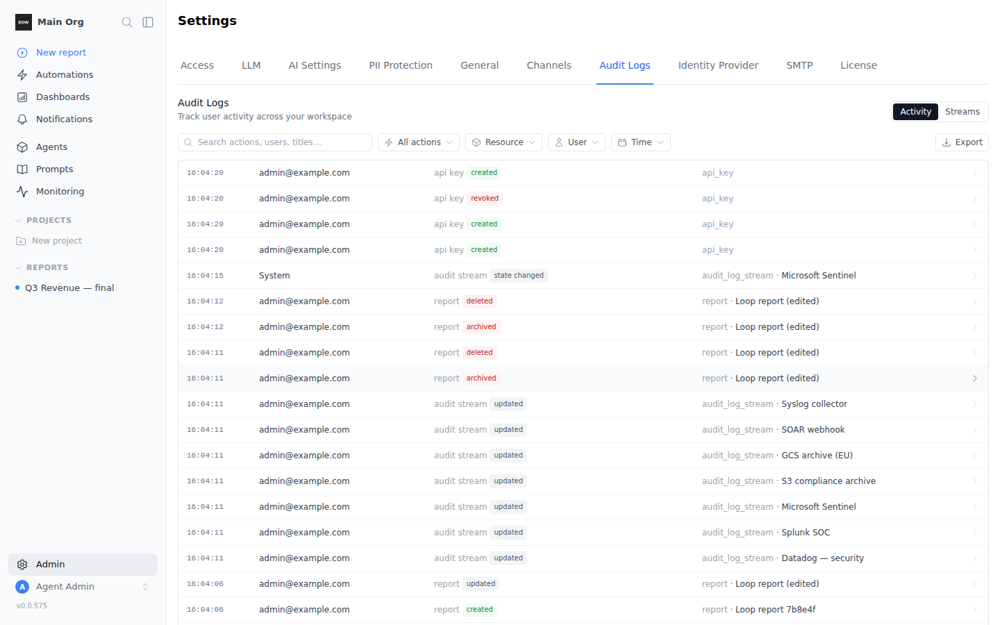
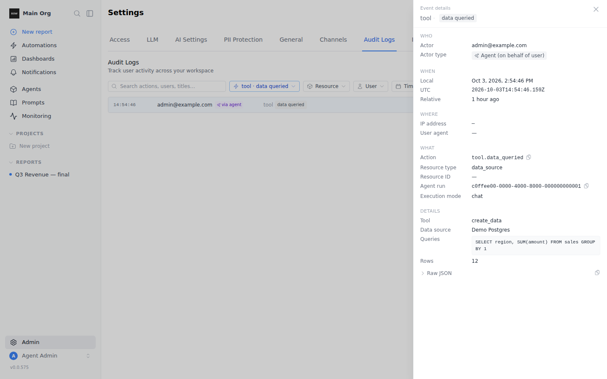
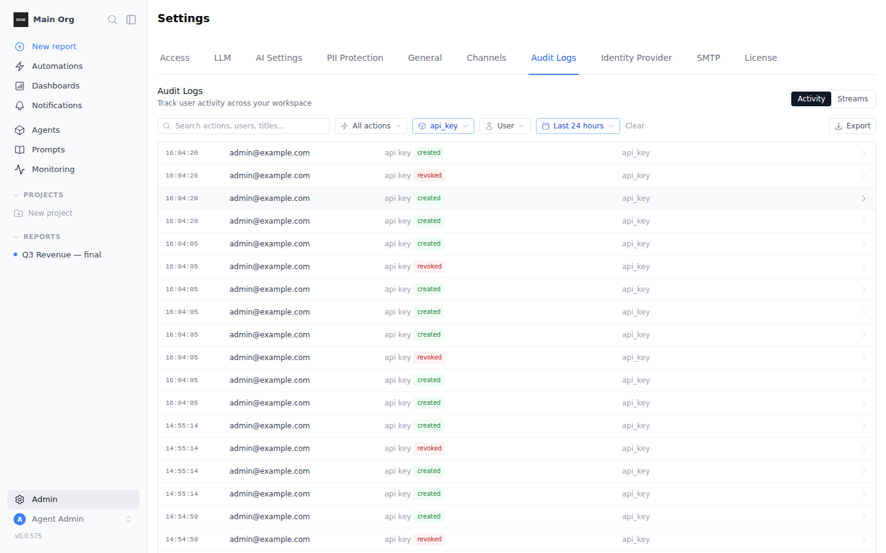
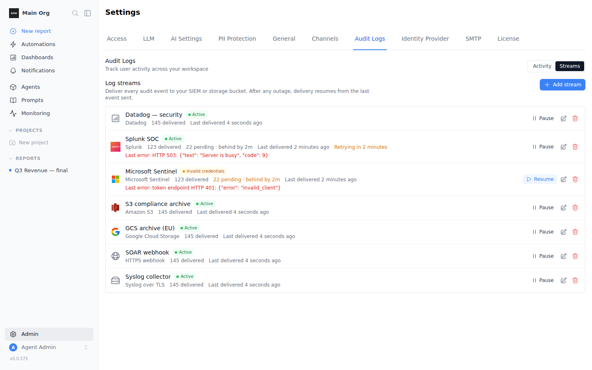
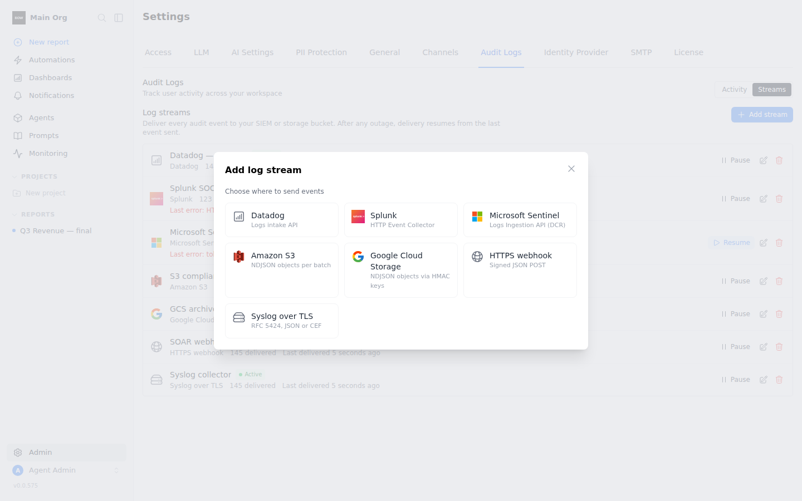

<Note>
The activity view and export are included in the Team and Enterprise licenses. Log streams need an Enterprise license.
</Note>

BOW records every security-relevant action in your organization: sign-ins, member and role changes, API keys, data sources, reports, settings, and every tool call an agent makes. You can browse and filter the log in the app, download it as JSON or CSV, and stream it continuously to Datadog, Splunk, Microsoft Sentinel, Amazon S3, Google Cloud Storage, Amazon CloudWatch Logs, an HTTPS endpoint or a syslog collector.

Open it from **Settings → Audit Logs**. The page has two tabs: **Activity** and **Streams**.

## What is recorded

Each event has an action such as `api_key.created`, `member.role_changed` or `tool.data_queried`, the actor, the resource it touched, the outcome (`success`, `failure` or `denied`), when it happened, the client address and user agent, the request ID and session ID, and action-specific details.

### Sign-in and account events

| Action | When | Outcome |
|---|---|---|
| `auth.login` | A user signs in with a password, LDAP, OAuth, OIDC or SAML. | `success` |
| `auth.login_failed` | A sign-in fails, for example a wrong password, a disabled account, or password sign-in not allowed for the account. | `failure`, with a reason such as `invalid_credentials`, `account_disabled` or `local_login_not_allowed` |
| `auth.logout` | A user signs out. | `success` |
| `auth.password_changed` | A user changes their password. | `success` |
| `auth.password_reset_requested` | A password reset is requested. | `success` |
| `auth.password_reset` | A password is reset. | `success` |

An event about a known account is recorded in every organization the account belongs to. A failed sign-in for an email that has no account belongs to no organization, so it never appears in an organization's activity. To collect those, configure a [platform stream](#platform-stream).

### Data access events

| Action | When |
|---|---|
| `report.viewed` | A member opens a report. |
| `report.public_viewed` | A published report is opened through its public link. The details say whether the viewer was signed in (`member`) or `anonymous`. |
| `query.executed` | A saved query is run or previewed. The details hold the code that ran, the row count and, on failure, the reason. Result rows are never logged. |
| `data_source.schema_viewed` | A data source's schema is read. The details hold the number of tables. |
| `tool.data_queried` / `tool.data_query_failed` | An agent runs a query. The details hold every query it ran and the row count. |

Agent events keep every query the agent ran, however many. If the queries together are larger than 32 KB, the longest are shortened and the details list which ones, with their original lengths.

### Permission denials

When a request is refused for lack of permission, BOW records an `access.denied` event with outcome `denied`. It holds the permission that was missing, the reason (such as `missing_permission`, `not_a_member` or `not_owner`), the resource the user tried to reach, the client address, the user agent and the request ID. Use these in your SIEM to alert on repeated denials from one user or address.

The actor is one of:

| Actor | When |
|---|---|
| **User** | A person did it in the app or through the API. |
| **Agent** | An agent did it while answering a user, for example running a query. The row shows the user it ran for, marked *via agent*. |
| **System** | BOW did it on its own, for example a log stream changing state after its credentials were rejected. |

Each event records the actor's email and name at the time it happened. If the user is later renamed or deleted, their past events keep the email and name they had.

Agent tool events are written durably: under heavy load or a short database outage they are queued, retried and, if needed, kept on disk until they can be written. They are not dropped.

## Activity



Each row shows the exact time, who acted, the action (resource and verb) and the target. Click a row to open its details: who, when (in your time zone, in UTC and relative), where from, and the parsed details, such as the SQL an agent ran or the fields that changed. The raw event JSON is there too, with a copy button.



### Filter and search

- **Search** matches actions, user emails and resource titles.
- **All actions** narrows to one action.
- **Resource** narrows to one or more resource types.
- **User** narrows to one member.
- **Time** narrows to a preset range or custom dates.

Filters combine, and they are kept in the page URL, so you can share a filtered view with another admin.



### Export

Click **Export** and choose **JSON** or **CSV**. The file holds every event that matches the current filters, oldest first, as of the moment you clicked.

- **JSON** is newline-delimited: one event per line, in the same [event format](#event-format) that log streams send.
- **CSV** has one row per event, with the details as a JSON column. Cells that a spreadsheet would treat as a formula are escaped.

An export can hold up to 100,000 events. For more, narrow the time range, or use a log stream. Each export is itself recorded as an `audit_log.exported` event, with the format and filters used.

## Log streams

A log stream delivers every audit event to an external system, continuously, within about 15 seconds of it happening.



### Add a stream

<Steps>
  <Step title="Choose a destination">
    In **Streams**, click **Add stream** and pick where events should go.

    
  </Step>
  <Step title="Fill in the connection details">
    Each destination asks for its own settings (see the table below). Secrets are encrypted and never shown again; when you edit a stream, leave a secret field as is to keep it.
  </Step>
  <Step title="Choose what to send">
    Under **Start from**, pick **New events only** or **Include all history**. To send only some events, list action prefixes in **Only actions starting with**, for example `tool., member.`. Leave it empty to send everything.
  </Step>
  <Step title="Send a test event">
    Click **Send test event**. BOW sends one `audit_stream.test` event with your settings and shows the destination's answer. Fix any error before saving.
  </Step>
  <Step title="Save">
    Click **Save stream**. Delivery starts on the next cycle.
  </Step>
</Steps>

### Destinations

| Destination | What you need | How events arrive |
|---|---|---|
| **Datadog** | Site and API key | Logs API, one log per event, `service:bagofwords` by default |
| **Splunk** | HTTP Event Collector URL and token; optional index | HEC events, sourcetype `bagofwords:audit` |
| **Microsoft Sentinel** | Tenant ID, client ID and secret of an app registration; data collection endpoint URL; data collection rule immutable ID; stream name | Logs Ingestion API into your custom table |
| **Amazon S3** | Bucket and region; an IAM role ARN or access keys | Newline-delimited JSON files under `prefix/YYYY-MM-DD/`, optionally gzipped |
| **Google Cloud Storage** | Bucket and HMAC keys | Same file layout as S3 |
| **Amazon CloudWatch Logs** | Log group, log stream and region; an IAM role ARN or access keys | One log event per audit event, timestamped with when it happened |
| **HTTPS webhook** | Endpoint URL; optional auth header and signing secret | `POST` of a JSON array of events |
| **Syslog** | Host and port; TLS on by default | RFC 5424 over TCP or TLS, JSON or CEF message |

<AccordionGroup>
  <Accordion title="Amazon S3 with an IAM role">
    Enter the **Role ARN** instead of access keys. When you save, BOW generates an **External ID** and shows it in the stream form. Add it to the role's trust policy as the `sts:ExternalId` condition. The role needs `s3:PutObject` on the bucket and prefix.
  </Accordion>
  <Accordion title="Amazon CloudWatch Logs">
    The log group defaults to `/bagofwords/audit`, the log stream to `audit` and the region to `us-east-1`. If the log stream doesn't exist, BOW creates it, and creates the log group too unless you turn off **Create log group** under **Advanced settings**. The credentials need `logs:PutLogEvents`, plus `logs:CreateLogStream` and `logs:CreateLogGroup` if BOW should create them.

    To use an IAM role, enter the **Role ARN**. As with S3, BOW generates an **External ID** when you save; add it to the role's trust policy as the `sts:ExternalId` condition. For a VPC endpoint or a compatible service, set the CloudWatch and STS endpoint URLs under **Advanced settings**.
  </Accordion>
  <Accordion title="Verify HTTPS webhook signatures">
    If you set a signing secret, each request carries two headers:

    - `X-BOW-Timestamp`: Unix time in seconds.
    - `X-BOW-Signature`: `v1=` followed by the hex HMAC-SHA256 of `timestamp + "." + body`, keyed with your secret.

    ```python
    import hashlib, hmac, time

    def verify(secret: bytes, timestamp: str, body: bytes, signature: str) -> bool:
        if abs(time.time() - int(timestamp)) > 300:
            return False
        expected = hmac.new(secret, timestamp.encode() + b"." + body, hashlib.sha256).hexdigest()
        return hmac.compare_digest("v1=" + expected, signature)
    ```

    Respond with any `2xx` to acknowledge the batch.
  </Accordion>
  <Accordion title="Syslog with a private CA or mutual TLS">
    Under **Advanced settings**, paste your CA certificate to trust a private collector, and a client certificate and key for mutual TLS.
  </Accordion>
</AccordionGroup>

### Delivery guarantees

- **Every event, in order, at least once.** A stream remembers the last event it delivered and resumes from there after any outage, pause, edit or restart. No event is skipped.
- **Deduplicate on `id`.** In rare cases, such as a restart in the middle of a send, an event can be delivered twice. It has the same `id` both times. S3 and Cloud Storage files from a retried batch overwrite the same object.
- **Pause and edit are safe.** Pausing stops delivery after the current batch. Editing a stream's settings resends anything that was not yet confirmed to the new settings.

### Status and retries

Each stream shows its state, how many events it has delivered, how many are pending and how far behind it is, and the last error.

| State | Meaning | What happens |
|---|---|---|
| **Active** | Delivering. | If the destination is busy or unreachable, the stream shows **Retrying** and tries again with growing waits, up to 15 minutes apart. After 5 failures in a row it is reported as degraded (see below) and keeps retrying. |
| **Paused** | Stopped by an admin. | Events wait. **Resume** delivers them. |
| **Invalid credentials** | The destination rejected the credentials or certificate. | Delivery stops. Fix the settings, then save or **Resume**. |
| **Error** | The destination rejected the events for another reason, for example a missing bucket. | Delivery stops until the settings are fixed. |

When a stream moves to **Invalid credentials** or **Error**, the organization's admins get an email, and the change is recorded as an `audit_stream.state_changed` event. No events are lost while a stream is stopped.

When a stream keeps failing but has not stopped, BOW records an `audit_stream.degraded` event and emails the organization's admins once. When the next batch goes through, it records `audit_stream.recovered`.

#### Heartbeats

Every 5 minutes, BOW writes an `audit.heartbeat` event for each organization that has an active stream. Alert in your SIEM when heartbeats stop arriving: that tells you delivery or recording has stopped, not that the workspace is just quiet.

#### Health endpoint

`GET /api/enterprise/audit/health` returns the state of audit recording and delivery for your organization. It needs the `view_audit_logs` permission.

- **Recording:** queue depth, failed writes, events held on disk and replayed, and events not yet prepared for delivery.
- **Streams:** for each stream, its state, pending events, how far behind it is, consecutive failures, when it became degraded, the next attempt, the last delivery and the last error.
- **Heartbeat:** the interval and when the last heartbeat was written.
- **Retention:** the retention period and whether a legal hold is on.

## Event format

Log streams and JSON export use the same versioned format:

```json
{
  "id": "6f1c…",
  "version": 1,
  "schema_version": 2,
  "legacy": false,
  "action": "api_key.created",
  "category": "administration",
  "occurred_at": "2026-10-03T12:00:00.123Z",
  "recorded_at": "2026-10-03T12:00:00.125Z",
  "outcome": "success",
  "failure_reason": null,
  "organization": { "id": "…", "name": "Acme" },
  "actor": { "type": "user", "id": "…", "email": "admin@example.com", "name": "Dana Admin" },
  "targets": [{ "type": "api_key", "id": "…", "name": "CI key" }],
  "context": { "ip_address": "203.0.113.10", "user_agent": "Mozilla/5.0 …" },
  "correlation": { "request_id": "…", "session_id": "…", "parent_id": null, "execution_id": null },
  "metadata": { }
}
```

| Field | Description |
|---|---|
| `id` | Unique event ID. Use it to deduplicate. |
| `version` | Format version, currently `1`. |
| `schema_version` | `2` for events recorded with outcome, event time and correlation; `1` for older events. |
| `legacy` | `true` for older events: their outcome is inferred, their two times are equal and they have no correlation IDs. |
| `action` | What happened, as `resource.verb`. |
| `category` | `authentication`, `authorization`, `administration`, `data_access`, `agent`, `background`, `platform` or `other`, derived from the action. |
| `occurred_at` | When it happened, UTC, ISO 8601. |
| `recorded_at` | When it was written. Later than `occurred_at` if the event was queued. |
| `outcome` | `success`, `failure` or `denied`. |
| `failure_reason` | A short code such as `invalid_credentials` or `missing_permission`, when the outcome is not `success`. |
| `actor.type` | `user`, `agent`, `system`, `service` or `unknown` (a failed sign-in for an account that doesn't exist). |
| `actor.email`, `actor.name` | Who the actor was when the event happened. |
| `targets` | The resources the action touched. |
| `context` | Client address and user agent of the request, when there was one. |
| `correlation` | `request_id` and `session_id` of the request; `parent_id`, the request that started a background job; `execution_id`, the agent run. |
| `metadata` | Action-specific details, such as the changed fields or the query an agent ran. |

The request ID is the `X-Request-ID` header the client sent, if it is valid, or a new one. BOW returns it in the response's `X-Request-ID` header, so you can match a request to its audit events. The session ID is a random ID created at sign-in; it is the same for every event in that session and cannot be used to sign in. API keys have no session ID.

Secrets in event details, such as passwords, tokens and API keys, are replaced with `[REDACTED]`.

## Permissions

| Task | Permission |
|---|---|
| View the activity, export it, view streams | `view_audit_logs` |
| Add, edit, pause, resume or delete a stream; send a test event | `manage_settings` |

Creating, changing, pausing, resuming and deleting a stream are recorded as `audit_stream.*` events.

## Platform stream

A failed sign-in for an email that has no account belongs to no organization, so no organization stream delivers it. To collect these events, configure a platform stream in `bow-config.yaml`. It takes any destination type and the same settings as an organization stream:

```yaml
audit:
  platform_stream:
    enabled: true
    destination: splunk
    config:
      hec_url: https://collector.example.com/services/collector
    secrets:
      token: ${AUDIT_PLATFORM_HEC_TOKEN}
```

BOW sets it up when it starts and delivers with the same guarantees as other streams. It doesn't appear in **Settings → Audit Logs**. If it fails, BOW writes an error to the server log instead of emailing admins.

## Self-hosted notes

- **Encryption key.** Stream secrets are encrypted with `BOW_ENCRYPTION_KEY`, like data source credentials. Keep it stable. If it changes, streams with secrets move to **Invalid credentials** until you re-enter their secrets; no events are lost.
- **Network access.** The server must reach the destination. On restricted networks, allow the destination's endpoint, or stream to an internal syslog collector or HTTPS endpoint.
- **Delivery interval.** Streams are checked every 15 seconds by default. Set `BOW_AUDIT_STREAM_INTERVAL_SECONDS` to change it.
- **Client address behind a proxy.** BOW takes the client address from `X-Forwarded-For` only when the request comes from a trusted proxy. By default those are loopback and private network ranges, which covers a reverse proxy on the same host or Docker network. On a shared network, set `security.trusted_proxies` in `bow-config.yaml`, or `BOW_TRUSTED_PROXIES` as a comma-separated list, to exactly your proxies' addresses or CIDR ranges. Set it to an empty list to always record the address of the direct connection.
- **Retention.** Audit events are kept forever by default. Set `BOW_AUDIT_RETENTION_DAYS` (`audit.retention_days`) to delete older events once a day. An event is deleted only after every stream of its organization has delivered it, and each purge is recorded as an `audit.retention_purged` event. Set `BOW_AUDIT_LEGAL_HOLD=true` (`audit.legal_hold`) to stop all deletion.
- **Heartbeats and degraded alerts.** Set `BOW_AUDIT_HEARTBEAT_INTERVAL_SECONDS` to change the heartbeat interval (300 by default, `0` turns heartbeats off), and `BOW_AUDIT_DEGRADED_AFTER_FAILURES` to change how many failures in a row mark a stream as degraded (5 by default).
- **Query size in agent events.** Set `BOW_AUDIT_MAX_QUERY_PAYLOAD_BYTES` to change the 32 KB limit on the queries kept in one agent event.
