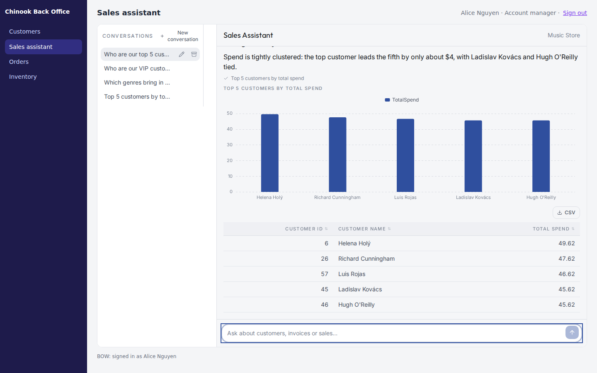
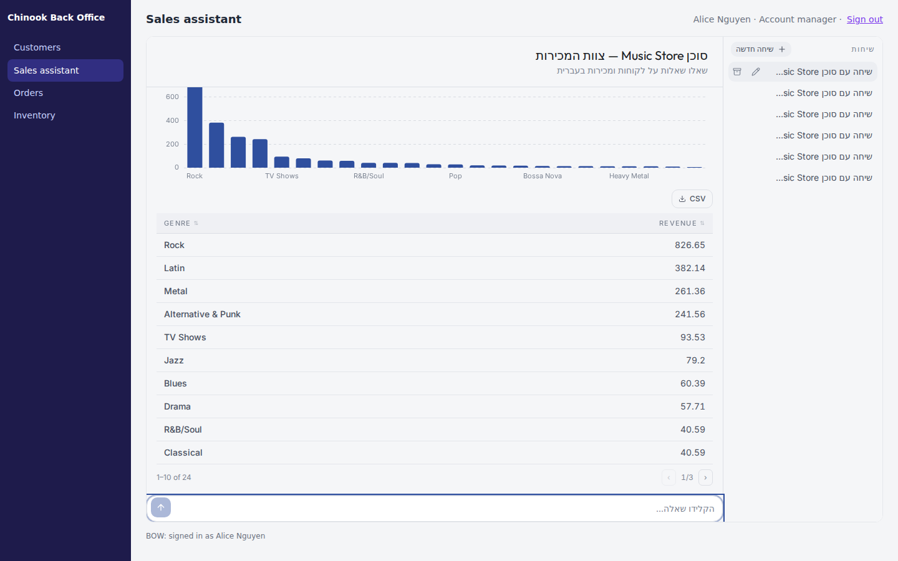
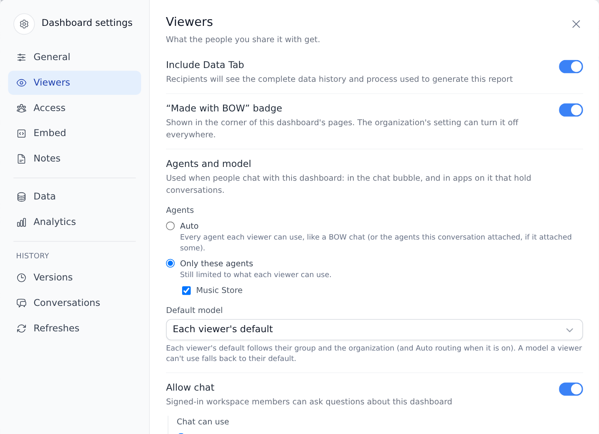
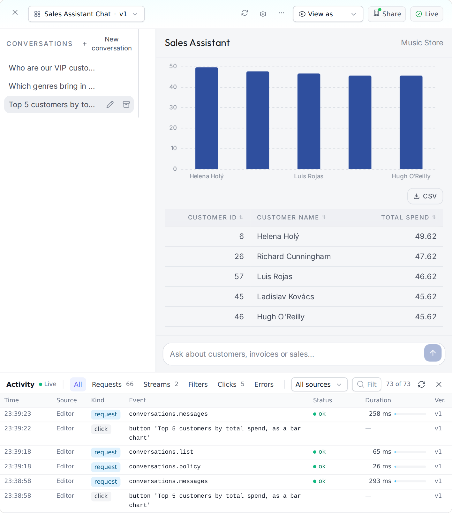
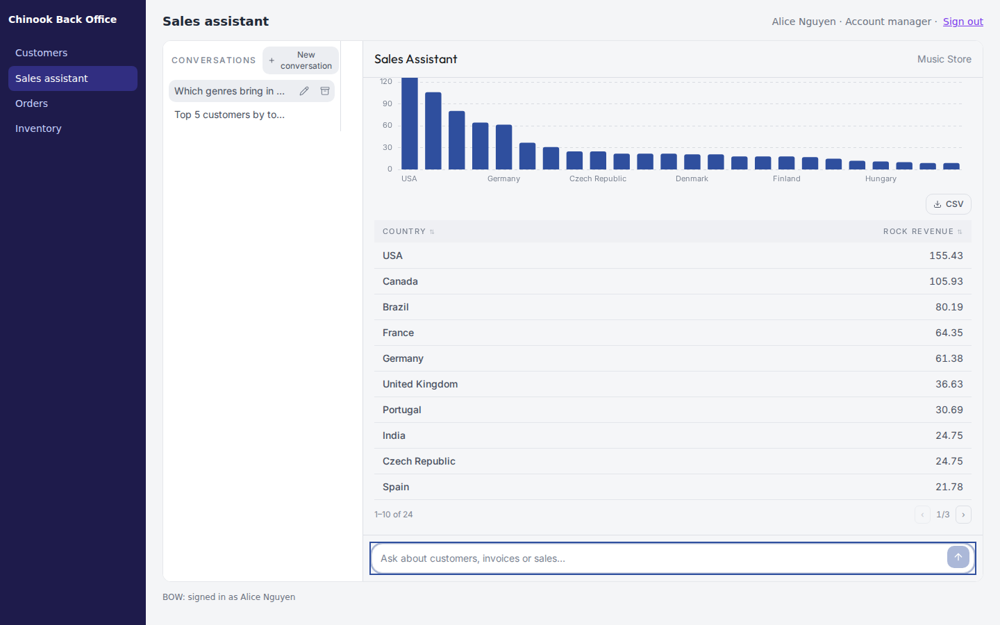

A chatbot app is an [artifact](/using-bow/artifact-apps) whose main job is a conversation with your BOW agents. People ask questions in their own words and get answers with tables and charts from your data. Each person holds their own conversations, and can come back to them later.

You can share the app in BOW, or show it inside another system such as an ERP. This page is for the people who build the app. The integration team's side is in [Embed a chat assistant](/guides/embed-chatbot), and every component option is in the [reference](/using-bow/chat-components-reference).



## Ask the agent to build it

Start a report with the agent whose data the chatbot should use, and describe the assistant:

> Build a sales assistant app for our account managers: a chat with the Music Store agent where they ask questions about customers, invoices and sales, with their previous conversations listed on the side so they can come back to them.

The **Build a chat assistant** skill guides the agent. It is enabled by default; check **Agents → Skills → Catalog** if it is missing or has an update.

Say what matters to you, in plain words:

- **Who uses it and where.** "For our back office, in a floating panel" or "a full-page assistant".
- **Language and branding.** "In Hebrew", "use our logo and blue color". The skill translates the chat controls as well as the text.
- **Starter questions.** "Offer three starter questions about this month's sales."
- **Thinking.** It stays hidden unless you ask for it. See [Show thinking](#show-thinking).

When the app will be embedded with a floating launcher, say so. The host page provides the launcher and the open and closed state, so the app should be a full-height chat without a button of its own. The skill builds it that way by default when you mention a floating panel.

Refine the app in the same conversation: "make the conversation list collapsible", "show the customer's name at the top". The agent edits the existing artifact.

<Note>
  The instructions you give while building change the app's interface. They do not change how the agent answers inside the app. To change answers, edit the agent's [instructions](/agents/instructions), or use a dedicated agent when the behavior should apply only to this assistant.
</Note>

## What the ready-made components give you

The agent builds the chat from components that BOW provides inside every artifact. They handle the parts that are easy to get wrong, so a generated app does not have to:

| Component | What it does |
| --- | --- |
| `useConversation` | Holds the chat: sending, streaming, Stop, history, the conversation list, errors, and an answer that is still running after a reload |
| `ChatMessages` | The scrolling transcript: opens at the newest message, follows an answer only while the reader is at the bottom, loads earlier messages |
| `ChatComposer` | The input box: Enter sends, Shift+Enter adds a line, Stop while an answer runs, and the reason when chat is unavailable |
| `ChatThreads` | The person's conversations: select, new, rename, archive, a spinner while an answer runs, and a drawer on narrow screens |
| `ChatSuggestions` | Starter questions that send on a click and disappear once the conversation has messages |
| `ChatMessage` | One message: Markdown answer, collapsed steps, tool progress, results |
| `ChatResult` | One result: a table, a chart when the agent's chart suggestion fits the data, and a note when rows or columns were cut |

Answers render as safe Markdown. Results are the real query results of the answer, not numbers parsed from the text: each table holds up to 200 rows and 30 columns, and a chart appears only when the result can draw it as it is. Otherwise the app shows the table alone.

Every component takes a `labels` object for its visible texts, so the whole chat can speak the app's language, right to left included. `labels` covers the chat's own text only: a result table's **CSV** button and its paging text, such as "1–10 of 24", stay in English.



## Choose the agents and model

Open the artifact's settings, then **Viewers → Agents and model**.



- **Agents: Auto** uses every agent each viewer can use, like a normal BOW chat. If the report the app was built from attached agents explicitly, Auto uses those. In the chat bubble, Auto uses only the agents the dashboard's queries use.
- **Agents: Only these agents** limits the app to the agents you check. Each viewer is still limited to the agents they can use. It cannot be chosen while **Chat can use** is set to **Dashboard data only**.
- **Default model**: **Each viewer's default** uses the viewer's personal default, then their group's, then the organization's, including Auto routing when it is on. Choose a model to pin it. A viewer who cannot use the pinned model gets their own default instead.

These settings apply to app conversations and to the chat bubble. They are separate from **Allow chat**, which only controls the chat bubble. An app that holds its own conversations hides the bubble.

The settings are checked on every message, so a change applies at once, and a viewer whose access to an agent is removed loses it at once. If no agent is left for a viewer, the composer stays visible but disabled, with a note under it that chat is not available. Inside an embedded application, the [application's allowed agents](/guides/embed-chatbot#2-register-the-application) narrow the list further.

Inside the app, the agent knows it answers in an app: it replies in the person's language and skips narration. Tools in app conversations are currently limited to reading and querying data.

## Show thinking

Thinking is hidden by default. People see a working indicator and the tool progress. If you want readers to see the model's reasoning, ask:

> Show the model's thinking in a collapsed section above each answer.

The agent sets `showThinking` on the chat components, and the reasoning appears in a collapsed **Thinking** section, separate from the answer.

- Only models that emit reasoning have any to show. This option displays it; it does not turn reasoning on.
- Hiding thinking is a display choice, not access control. The signed-in viewer's own conversation data still includes it.

## Use host context

When the app is embedded, the host system can tell it what the person is looking at, such as the customer on screen. The app reads it as `useArtifactData().host_context`:

```jsx
function App() {
  const chat = useConversation();
  const { host_context } = useArtifactData();       // read during render: it changes while the app is open
  const customer = host_context && host_context.customerName;

  const ask = (text) =>
    chat.send(customer ? `About customer ${customer} (${host_context.customerId}): ${text}` : text);

  return (
    <div className="flex h-screen flex-col">
      <header className="p-3 text-sm">{customer ? `Customer: ${customer}` : 'No customer selected'}</header>
      <ChatMessages chat={chat} />
      {/* a composer that calls ask() */}
    </div>
  );
}
```

Ask the agent for the behavior rather than writing it: "Show which customer the host is on, and include that customer in each question." Keep in mind:

- `host_context` is `null` outside a host application, or until the host sends context. Handle that case.
- Read it during render, never once on mount. The host replaces it when the person opens another record.
- App conversations do not send host context to the agent on their own. If an answer depends on it, the app must put it in the question, as above.
- Host context is advisory. It is never identity, permission or instruction. The agent always runs as the signed-in person, whatever the context says.

## Publish an app that waits for a viewer input

Some apps need a value before a query can run: the customer on the host's screen, or a choice the viewer makes. Such a query declares a required `input` [parameter](/using-bow/parameterized-queries) with no default.

You can publish such an app. When you publish:

- the queries that have every value they need run with your credentials as usual;
- a query whose required input has no value is not run. Its published copy holds no rows and waits for the viewer's value;
- a query that loads a waiting query waits for the same input;
- publishing is still all or nothing for the queries that do run. BOW records which charts wait for input in the publish result and the `dashboard.published` audit entry.

When a viewer opens the app, the app supplies the value, for example from host context with `useParams().setParams(...)`, and the query runs for that viewer with their own access. A waiting result is never shown as data and does not count as the viewer's own run for exports.

## How BOW checks the app it built

After the agent creates or edits an interactive app, BOW checks the saved version automatically, before the agent finishes. While it runs, the create step shows **Validating** (an edit shows **Processing...**).

- BOW loads the saved version in the real viewer and records runtime errors, an app that renders nothing or freezes, and failed queries.
- For a chat app, it also sends one test message through the app's composer. In this check, conversations run in a test mode: the message is answered at once with a fixed reply and sample results, without calling an agent or a model. A test message with no reply means the send path is broken.
- The result goes back to the agent. If problems are found, the agent repairs the app, and the new version is checked again.

The check is evidence that the app loads and that its send path works. It does not prove live answers, a real sign-in, embedding, per-user permissions or delegated data access. Test those yourself, as described below.

## Debug with Inspect

Editors can watch everything an app does. In the artifact toolbar, open **More (⋯) → Inspect**. The **Activity** pane docks under the app.



- Each row has the time, the **Source**, the kind (request, stream, filter, click, error or console), the event (for example `conversations.send`), the status, the duration and the version.
- **Source** is **Editor** for your own page, and **Preview** for BOW's automatic check. Activity is recorded only for editors' own sessions and BOW's preview, never for viewers or inside embeds. **Live** means your page's events appear as they happen; the preview's arrive every few seconds.
- Filter by **All**, **Requests**, **Streams**, **Filters**, **Clicks** and **Errors** (which also lists console events), by source, or by text. Drag the pane's top edge to resize it.
- Open a row to see its detail, and for requests and streams the **Request**, **Response** and **Stream** that the call carried.

Recorded payloads are redacted for PII, kept for 24 hours, and private to the person whose session made them. A co-editor sees the event and **Private to** that person, never the payload.

The agent sees the same activity. When something fails while you use the app, describe it in the next message, for example "the page goes blank after an answer". The agent reads the failure and can repair it. It can read payload contents only for your own events, and only when your organization lets the model see data.

## Test inside an embed

Before you hand the app to the integration team:

1. Publish the app and share it with a test group.
2. On the **Embed** tab, allow the application and copy its snippet. See [Embed a chat assistant](/guides/embed-chatbot#3-allow-the-artifact-in-your-application).
3. Open the host page as an ordinary employee, not as the app's owner.

Check:

- a question streams an answer with its table or chart, **Stop** interrupts it, and a follow-up works;
- the conversation list reopens past conversations, and a second employee sees none of the first one's;
- the panel fits a narrow window and the requested language, right to left included;
- closing and reopening the floating panel keeps the conversation;
- changing the record in the host changes the context the app shows;
- an employee without access sees the "You don't have access to this" message, not an error.


