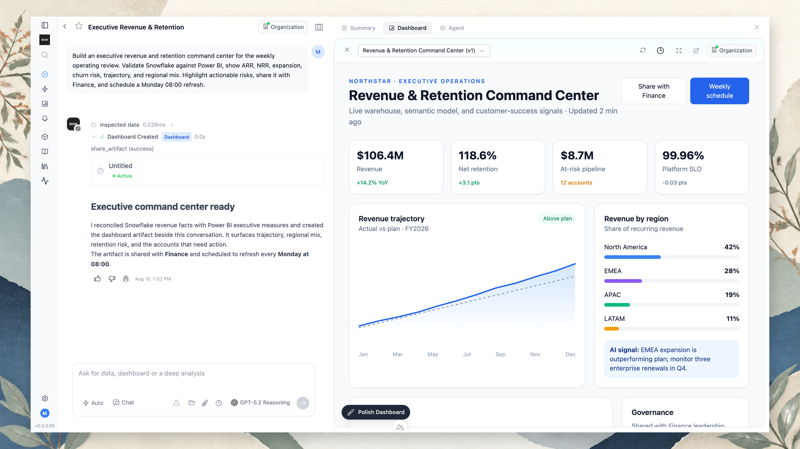

A dashboard is an **artifact created through the conversation**. Describe the operating view you need, the agent validates the underlying evidence, and the finished dashboard opens beside the chat that produced it.

## Create a dashboard

Ask for the audience, decisions, metrics, comparisons, and operating cadence in one prompt. For example:

> Build an executive revenue and retention command center for the weekly operating review. Validate Snowflake against Power BI; show ARR, NRR, expansion, churn risk, trajectory, and regional mix; highlight actionable risks; share it with Finance; and schedule a Monday 08:00 refresh.

The agent can inspect data, reconcile measures, create the artifact, and complete sharing or scheduling steps in the same run. The conversation remains visible on the left, so the request, evidence, and changes stay attached to the result.

If the request is open-ended or could be read in materially different ways, the agent asks its clarifying questions before it starts building — usually with two or three concrete options to pick from. Once it has started, it finishes the build and notes any limits or surprises in the data on the page, asking again only if something truly blocks it.

## Refine the artifact in chat

Continue the conversation to change the dashboard. Ask the agent to:

- add or remove a KPI, chart, table, or explanatory section;
- change the audience or level of detail;
- investigate an anomaly before updating the narrative;
- compare a different period, segment, or scenario;
- improve the visual hierarchy or presentation;
- publish a new version after the underlying logic changes.

Each change is described in natural language and applied to the artifact through the conversation.

## Apps with saved data

An artifact can also be an app with saved records, private uploads and streamed AI responses. Ask for a task board, blog or document helper in the same conversation. See [Build apps with artifacts](/using-bow/artifact-apps) for setup, permissions and examples.

For resource-backed apps, **⋯ → Resources** opens the read-only record explorer and **⋯ → Analytics** shows artifact views. These are separate from the report's analytical query results.

## Review and present

Use the artifact toolbar to refresh the view, inspect versions, open it in a larger view, or share it. Keep the chat open when you need the evidence trail; use the expanded artifact view for operating reviews and presentations.

## Find a dashboard

The **Dashboards** page in the sidebar lists every dashboard you can open, with **My dashboards** and **Shared with me** tabs. Each dashboard shows when it was created and last edited, who owns it, and whether it is published or has unpublished changes; on shared dashboards, a label says how it reached you — shared directly, through a group or project, or with the whole organization.

- **Search** by dashboard title or owner.
- **Filters** narrow the list by agent, created or edited date (presets such as **Last 7 days**, or a custom range), owner, and status (**Published**, **Unpublished changes**, **Draft**), or to **Starred only**.
- **Sort** by **Recently edited**, **Newest created**, **Oldest created**, **Title A–Z**, or **Recently published**.
- Switch between **Grid** and **List** view.
- **Star** the dashboards you return to.

**Needs attention** points out dashboards failing to refresh and ones not edited in 90 days.

## Share and schedule

Share an artifact with the people who need the operating view and choose the appropriate visibility. Schedule recurring refreshes or delivery so the view stays current without rebuilding it each week.

When the source data or business definition changes, ask the agent to validate the difference before publishing an updated version. The report preserves the prompt and tool history behind the dashboard.

### Request access

When you open a dashboard that is private or shared with specific people, and you aren't one of them, BOW shows **You don't have access** with the owner's name. Select **Request access**, add an optional note, and **Send request**. The owner and the editors added by name are notified in-app and by email.

Any editor answers from the dashboard's **Share** dialog, under **Pending requests**, with **Approve** or **Deny**. The first answer wins. Approving adds the requester as a viewer — a private dashboard switches to **Specific people** — and tells them they can now view it. Denying is silent; the person can ask again after 7 days.

Access requests are controlled by **Allow access requests** in **Settings → AI** (default: on). When it is off, the no-access page only names the owner to ask, and no new requests can be sent; requests already sent can still be answered.

### What viewers get

**Dashboard settings → Viewers** controls what the people you share a dashboard with see:

- **Show details on widgets** — adds an ⓘ to each widget that opens its data, code, and calculation. Off by default.
- **“Made with BOW” badge** — shown in the corner of the dashboard's pages. On by default; turn it off for this dashboard. **Show "Made with BOW" credit** in **Settings → General** turns it off for every dashboard in the organization.

### Embed in other applications

**Dashboard settings → Embed** picks the host applications that may show the dashboard and gives the snippet each one pastes. Under **Permissions**, **Allow links to open in a new tab** lets links and buttons in the dashboard open new tabs or pop-up windows. It is off by default, so the dashboard can't open them.

## Add interactive filters

Ask the agent to make a field a filter — "let the viewer filter by region", "add a customer selector" — and it adds a control to the top of the dashboard backed by a [parameterized query](/using-bow/parameterized-queries). Changing the control re-runs the affected queries at the source and refreshes those visualizations in place; the rest of the dashboard is untouched. Choices for a control come from a fixed list or from another query in the report, never from the rows the control filters.

## Personalize a dashboard per viewer

A dashboard can show each person their own data while everyone opens the same artifact. Bind a filter to the viewer's identity — "scope this to the signed-in user's team" — and it becomes an **identity parameter**: resolved on the server per viewer, never editable, never sent from the browser. One dashboard, and each viewer sees only their slice.

How results and credentials resolve when you share a personalized dashboard:

- **Run on my behalf.** Shown when the dashboard uses per-user data connections. By default, each viewer's queries run with their own connection, so a source that enforces its own row-level security filters per person. Turn on **Run on my behalf** to let viewers' runs use your connection instead; each viewer still sees only their own results. It isn't available when the dashboard uses row-level security.
- **Per-viewer results.** Each viewer's data is computed and cached for them. Your saved snapshot is **withheld** from other viewers — no one sees the rows you last ran with.
- **Fresh on open.** Personalized dashboards re-run for the viewer when opened, so each person lands on their own current data rather than a stale shared snapshot.
- **Hide the underlying data.** You can hide the **Data** tab on a shared report so viewers see the dashboard without the raw query results behind it.

<Warning>
  For a source that already models per-user visibility (a Power BI tenant with RLS, a warehouse with row-level security), personalize with a **per-user connection** and leave **Run on my behalf** off, so the source filters under each person's own credentials. An identity parameter alone scopes by a value BOW resolves from the profile — use it for application-level slicing, not as a replacement for source-enforced security. See [Authentication](/data-sources/authentication).
</Warning>

## Preview as another viewer

Before you share, check what someone else will see. **View as** re-renders the dashboard as another organization member — searchable by name or email — or as an anonymous viewer, so you can confirm a personalized dashboard is scoped the way you intended.

<Note>
  On a **per-user (delegated)** source such as Power BI or Fabric, View-as swaps the identity used for parameter binding but keeps **your** source credentials — using the target's stored token would be impersonation. So the preview shows _your_ source-level rows under their identity binding. To verify the exact rows another person gets from a delegated source, have them open the shared dashboard themselves. BOW shows an amber caveat on the control in this case.
</Note>

<Tip>
  Ask for the “so what,” not only the charts. A strong dashboard prompt requests exceptions, risk signals, decisions, and recommended actions alongside the metrics.
</Tip>
