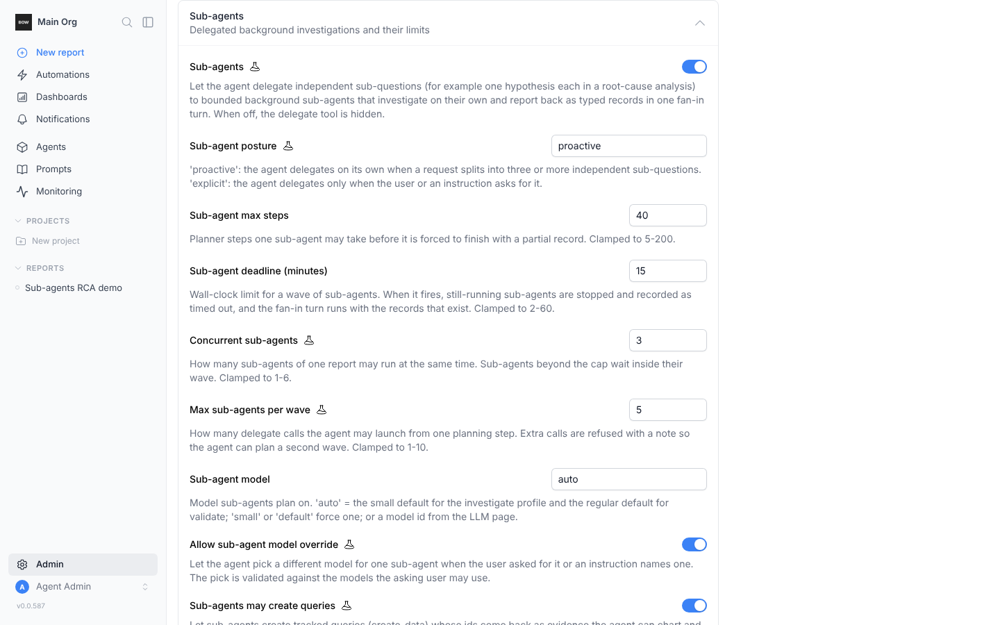

Control how the AI agent behaves across your organization. AI Settings requires the **Manage settings** permission.

To open it, select **Admin** in the sidebar, then **AI Settings** in the admin menu.

## Finding a setting

Settings are grouped into collapsible sections. Each closed section shows how many settings it holds and how many are on. **Data access & privacy** starts open, and BOW remembers which sections you open in this browser.

Use the **Search settings…** box at the top to filter by a setting's name or description. Sections with matches open automatically. Searching for a section's title shows the whole section.

Some settings only appear while the setting above them is on. For example, **Demo data generation** shows under **Training Mode** once Training Mode is on. A beaker icon marks a beta setting, and a lock icon marks a setting that can't be changed.

Number and text settings save when you press Enter or leave the field. Toggles save immediately.

## Data access & privacy

What the AI can see and bring into a conversation.

* **Allow LLM to see data** (Default: on): Let the LLM see data as part of the analysis and user queries. When off, the AI sees only column names and statistics, not actual values, and the **Inspect Data** tool is disabled. Changing it in either direction requires typing `I AM SURE` to confirm.
  <Note>File uploads are unaffected by this setting and are still visible to the AI.</Note>
  * **Verify data apps** (Default: on, beta): Let the agent check interactive page artifacts with browser tools. Shown only while **Allow LLM to see data** is on.
* **Web Fetch** (Default: off): Let the agent fetch the contents of public HTTP and HTTPS URLs. Only text-like responses are returned and large bodies are truncated.

## Agent capabilities

What the agent can do while answering.

* **Training Mode** (Default: on): Let admins work with the agent to build documentation, instructions, semantics and guidelines.
  * **Demo data generation** (Default: off, beta): See [Demo data generation](#demo-data-generation).
* **Agent Notes** (Default: on, beta): Let the agent keep per-report working notes (plans, findings, todos). Notes show in the report but aren't shared knowledge.
* **Custom tables (beta)** (Default: off): Let connection admins define a query that BOW materializes to an encrypted local copy on a schedule, so agents answer from the cached result.
* **Artifact resources** (Default: off): See [Artifact resources](#artifact-resources).
* **Follow-up suggestions** (Default: on): After each answer in the web app, suggest a few follow-up questions. Generated on the small default model.
* **Voice input** (Default: off): Show a microphone button in the chat prompt box so users can dictate a prompt. Transcription runs in the user's browser (Chrome, Edge and Safari). Audio never reaches the BOW server, but the browser vendor's speech service may process it.

### Artifact resources

**Artifact resources** is off by default. Enable it to let artifacts use persistent records, private uploads and approved AI operations with streamed responses.

The setting enables the capability; it does not grant viewers access to every resource. Existing sharing and resource permissions still apply. Disabling it blocks resource access without deleting stored records or files.

See [Build apps with artifacts](/using-bow/artifact-apps) for examples and [updating installed skills](/agents/instructions#install-and-update-skills) if an existing organization still has older app-building guidance.

### Demo data generation

**Demo data generation** is off by default and appears under **Training Mode** while Training Mode is on. When it is on, admins who can manage connections can ask the agent in a Training session to design and generate a realistic mock dataset for any domain, then create suggested agents on it. The rows are generated by the organization's small default model.

See [Create a demo dataset](/guides/demo-dataset).

## Sandbox

What generated code can do beyond querying data. Pages and rows the code handles never pass through the model. Web fetch, the headless browser and Agent List writes are all off by default.

* **Web fetch in code** (Default: off): Give generated code an `http` client that fetches public URLs in bulk. Pages are read by the code, not by the model, so scraping many pages costs no extra tokens. This is separate from **Web Fetch**, which lets the agent itself read a page.
  * **Max URLs per code run** (Default: 1000): 1 to 10,000.
* **Browser in code** (Default: off): Give generated code a headless browser it can drive (open pages, click, type, scroll, read text) for sites that need JavaScript. It uses the URL allowlist of the agent's browser connection; without a browser connection it isn't offered.
  * **Allow form submissions from code** (Default: off): Let the code's browser send POST, PUT, PATCH and DELETE requests. When off, those requests are blocked, so the code can only read pages.
  * **Max browser pages per code run** (Default: 200): 1 to 2,000.
* **Write to Agent Lists from code** (Default: off): Let generated code submit rows to the conversation's [Agent Lists](/agents/lists). Rows are saved only after the run succeeds, so a failed or retried run writes nothing. Only the counts reach the model.
  * **Max list rows per code run** (Default: 5000): 1 to 50,000.
* **Reuse prior steps (load_step)** (Default: off): Let generated code reuse a prior step's results in the report instead of re-querying.
* **Machine learning (scikit-learn)** (Default: on): Let generated code train scikit-learn models (classification, regression, clustering, feature importance) on query results and uploaded files. Turn it off to keep generated code to pandas/numpy analysis.
  * **ML training row limit** (Default: 50000): Larger sources are sampled down to this many rows before fitting. Minimum 1000.

## Learning & memory

How the AI learns from users, feedback and usage.

* **User memory** (Default: on): Let the agent remember facts about each user across sessions, such as their work, projects and shorthand. Each user can see, edit and delete their memory. It is kept up to date overnight.
* **Autogenerate instructions** (Default: on): Suggest instructions from clarifications users give. For example: "Active users should exclude test accounts" becomes a suggested instruction.
* **Enable LLM Judge** (Default: on): Let the LLM judge the quality of the analysis and user queries.
* **Auto-suggest evals** (Default: on): When a user who can manage evals upvotes a response that produced data, draft an eval test case for review.
* **Agent overnight learning** (Default: on, beta): Each night, agents review their pending suggestions, feedback and usage and propose one consolidated improvement. What happens to it follows each agent's Self-Learning setting.
  * **Expire unreviewed AI suggestions after (days)** (Default: 30, beta): Suggested instructions still pending after this many days are closed as expired. 0 keeps them open forever.
* **Agent check-ins** (Default: on, beta): Let the agent follow up on its own after a conversation when something is worth revisiting. Follow-ups run as the user in the same report and notify them only when something meaningful changed.
  * **Check-ins per user per week** (Default: 2, beta)
  * **Check-in runs per day** (Default: 50, beta): Organization-wide cap.

## Tools & MCP

External MCP servers and custom API tools.

* **MCP & Custom API Tools** (Default: on, beta): Allow connecting external MCP servers and custom API endpoints to data sources as tool providers.
* **Tools max** (Default: 50, beta): How many external tools the agent gets as its own tools in one run. Past this number, the most used tools are kept and the rest stay reachable through tool search.

## Sub-agents

**Sub-agents** is on by default. When it is on, the agent can delegate independent sub-questions (for example one hypothesis each in a root cause analysis) to bounded background sub-agents that investigate on their own and report back as typed records in one turn. When it is off, the agent never delegates. See [Sub-agents](/using-bow/sub-agents).

<Frame>
  
</Frame>

The section holds the posture, the limits and the model:

- **Sub-agent posture** (Default: `proactive`): `proactive` lets the agent delegate on its own when a request splits into three or more independent sub-questions. `explicit` makes it delegate only when the user or an instruction asks for it.
- **Sub-agent max steps** (Default: 40): Planner steps one sub-agent may take before it is forced to finish with a partial record. 5 to 200.
- **Sub-agent max tokens** (Default: 400,000): LLM tokens one sub-agent may spend before it is told to finish. Steps bound time; this bounds cost. 20,000 to 5,000,000.
- **Sub-agent deadline (minutes)** (Default: 15): Wall-clock limit for a wave of sub-agents. When it fires, still-running sub-agents are stopped and recorded as timed out, and the agent answers from the records that exist. 2 to 60.
- **Concurrent sub-agents** (Default: 3): How many sub-agents of one report may run at the same time. The rest wait inside their wave. 1 to 6.
- **Max sub-agents per wave** (Default: 5): How many sub-agents the agent may launch from one planning step. Extra ones are refused with a note so the agent can plan a second wave. 1 to 10.
- **Sub-agent model** (Default: `auto`): The model sub-agents plan on. `auto` uses the same model as the main conversation (the report's model when one is set); `small` forces the small default model; a model id from the LLM page pins it.
- **Allow sub-agent model override** (Default: on): Let the agent pick a different model for one sub-agent when the user asked for it or an instruction names one. The pick is validated against the models the asking user may use.
- **Sub-agents may create queries** (Default: off): Let sub-agents create tracked queries whose results the agent can chart and cite. Off, sub-agents are research-only: they describe, inspect, read and take notes.

## Limits

Row caps, timeouts, retries and context sizes.

* **Limit row count** (Default: 1000): Rows shown in tables and data previews. 0 means no limit.
* **MCP data preview rows** (Default: 1000): Result rows returned inline to an external MCP client. The full result is always saved in the report. 1 to 10,000, and also bounded by **Limit row count**.
* **Max agent steps** (Default: 100): Planner steps (decisions or tool calls) the agent may take in one request, in regular and training mode. 1 to 500.
* **Agent loop retries** (Default: 2): How many times the agent may recover from an unexpected error during a run and retry instead of failing. 0 to 10.
* **Limit code retries** (Default: 2): Attempts the LLM gets to generate working code for a data request, including the first. 1 to 10.
* **Parallel tool calls** (Default: 4, beta): Tool calls from one plan step that may run at the same time. Up to 8. Calls against the same agent always run one at a time.
* **Query timeout (seconds)** (Default: 180): Default per-query timeout. A connection can override it.
* **Concurrent queries per connection** (Default: 4): Agent queries that may run against one connection at the same time. Extra queries wait for a slot. A connection can override it.
* **Max instructions in context** (Default: 50): "Always" instructions load first, then "smart" instructions fill the remaining slots.
* **Agent chooses smart instructions** (Default: off): The agent reads only the smart instructions it needs, instead of loading every match.
* **Top K schema** (Default: 10): How many schema tables are sampled from the data source into the agent's context.
* **Top K metadata resources** (Default: 10): How many metadata resources (dbt, markdown and others) are sampled into the agent's context.
* **Agent roster top K** (Default: 10): When a report has many agents, how many appear in full in the AI context; the rest are listed by name. 1 to 100.

## Workspace

Public links, webhooks, forks and data retention.

* **Public link sharing** (Default: on): Allow dashboards and conversations to be shared with anyone who has the link. When off, links that are already public only open for signed-in members of the organization; turning it back on restores them.
* **Allow access requests** (Default: on): Let members ask a dashboard's editors for view access from the no-access page. When off, the page just names the owner to ask and no new requests can be sent; requests already sent can still be answered.
* **Report Webhooks** (Default: on): Allow external systems to send events to reports through inbound webhooks.
  * **Max webhooks** (Default: 20): Active inbound webhooks per organization.
  * **Webhook rate limit (per minute)** (Default: 60): Deliveries above this are rejected.
* **Allow Forks** (Default: on): Allow users to fork published reports into their own workspace.
* **Widget Data Retention Days** (Default: 14): Days to keep widget data before purging. 7 to 365.
* **File retention (days)** (Default: 0): A nightly job deletes files older than this many days. 0 keeps files forever. Files used by a dashboard, files in an agent or project library, and uploads that feed a scheduled report are always kept. Up to 3650.

## Other

Settings not yet assigned to a section.

* **MCP Apps** (Default: on, beta): Show the interactive app an MCP server attaches to a tool inside the report chat, in a sandboxed frame. When off, tool results show as text only.

## Settings managed elsewhere

A few organization settings have their own controls on other admin pages:

* **Auto model router** and **LLM fallback** are on the [LLM](/using-bow/llm) page.
* The **MCP** endpoint and the **Excel Add-in** are on the **Channels** page.
* Who can view, edit and run generated code is set with the **View generated code** and **Edit and run custom code** permissions. See [Roles & permissions](/users/roles-and-permissions).
